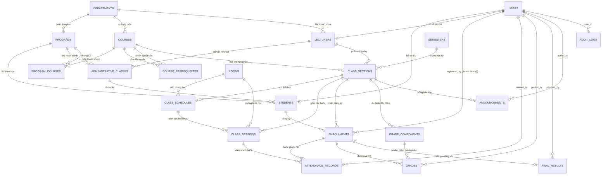
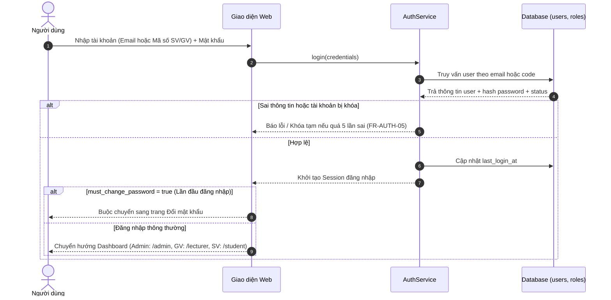
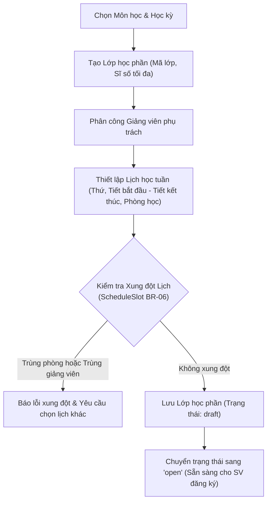
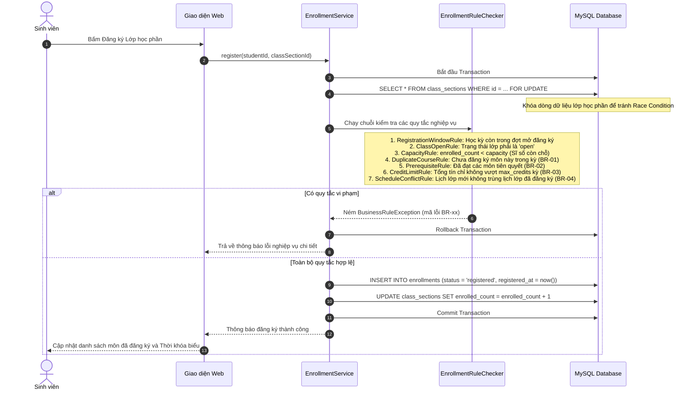
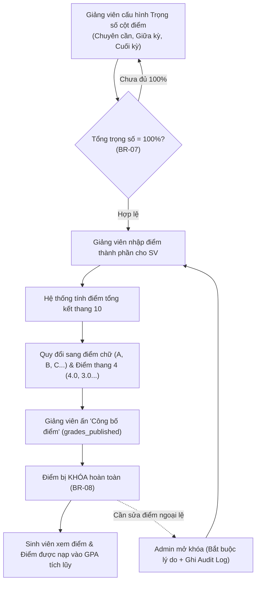

# BÁO CÁO TỔNG HỢP: HỆ THỐNG QUẢN LÝ SINH VIÊN (SMS)
## School Management System - Modular Monolith Architecture

---

## MỤC LỤC
1. [Tổng quan dự án & Mục tiêu](#1-tổng-quan-dự-án--mục-tiêu)
2. [Công nghệ & Kiến trúc hệ thống](#2-công-nghệ--kiến-trúc-hệ-thống)
3. [Cách thức hệ thống vận hành](#3-cách-thức-hệ-thống-vận-hành)
4. [Sơ đồ dữ liệu & Mô hình quan hệ](#4-sơ-đồ-dữ-liệu--mô-hình-quan-hệ)
5. [Các luồng nghiệp vụ xuyên suốt (Workflows)](#5-các-luồng-nghiệp-vụ-xuyên-suốt-workflows)
6. [Các quy tắc nghiệp vụ cốt lõi (Business Rules)](#6-các-quy-tắc-nghiệp-vụ-cốt-lõi-business-rules)
7. [Cấu trúc thư mục dự án & Nội dung chi tiết](#7-cấu-trúc-thư-mục-dự-án--nội-dung-chi-tiết)
8. [Hiện trạng và Kế hoạch triển khai](#8-hiện-trạng-và-kế-hoạch-triển-khai)

---

## 1. TỔNG QUAN DỰ ÁN & MỤC TIÊU

### 1.1. Mục tiêu sản phẩm
Hệ thống **Quản lý Đào tạo và Sinh viên (School Management System - SMS)** được thiết kế dành cho quy mô cơ sở đào tạo / khoa đại học theo mô hình **đào tạo tín chỉ**. Mục tiêu là xây dựng một nền tảng vận hành học vụ xuyên suốt, kết nối chặt chẽ giữa 3 tác nhân người dùng:
- **Quản trị viên / Cán bộ đào tạo (Admin)**: Khởi tạo cấu trúc đào tạo, mở lớp học phần, quản trị tài khoản, giám sát hệ thống và xem báo cáo tổng thể.
- **Giảng viên (Lecturer)**: Quản lý lớp được phân công, theo dõi lịch dạy, điểm danh buổi học, cấu hình trọng số và chấm điểm cho sinh viên.
- **Sinh viên (Student)**: Xem chương trình đào tạo, đăng ký/hủy học phần theo thời gian quy định, theo dõi thời khóa biểu, xem chuyên cần và kết quả học tập (GPA).

### 1.2. Quy mô & Phạm vi đề án
- **Nhân sự**: Nhóm 06 thành viên.
- **Thời gian thực hiện**: 03 tuần (21 ngày).
- **Phạm vi MVP cốt lõi**:
  1. Xác thực, phân quyền đa vai trò và quản lý tài khoản.
  2. Quản lý cấu trúc đào tạo: Khoa, Ngành, Lớp hành chính, Học phần/Môn học, Học kỳ, Phòng học.
  3. Mở lớp học phần, phân công giảng viên và xếp lịch học hàng tuần.
  4. Đăng ký/hủy học phần tự động với cơ chế kiểm tra điều kiện nghiêm ngặt và chống nghẽn sĩ số.
  5. Điểm danh theo từng buổi học thực tế và tính tỷ lệ chuyên cần.
  6. Quản lý thành phần điểm, khóa điểm, công bố điểm và tính điểm trung bình tích lũy (GPA).
  7. Báo cáo thống kê đào tạo và nhật ký kiểm toán (Audit Logs).

---

## 2. CÔNG NGHỆ & KIẾN TRÚC HỆ THỐNG

### 2.1. Technology Stack

| Thành phần | Công nghệ lựa chọn | Lý do sử dụng |
| :--- | :--- | :--- |
| **Backend** | PHP 8.3+ / Laravel 12 | Framework hiện đại, kiến trúc MVC mạnh mẽ, bảo mật cao, hỗ trợ ORM Eloquent, DI Container và Migration chuẩn mực |
| **Database** | MySQL 8.0 | Cơ sở dữ liệu quan hệ mạnh mẽ, hỗ trợ khóa dòng (`FOR UPDATE`), giao dịch (`Transaction`), `CHECK constraint` và chỉ mục tối ưu |
| **Cache & Queue** | Redis 7.0 | Tối ưu lưu trữ Session, cache danh mục danh mục đào tạo đọc nhiều, và hàng đợi xử lý ngầm (Mail, tính toán GPA) |
| **Frontend** | Blade + Bootstrap 5 + Alpine.js | Giao diện responsive, dễ đồng bộ giữa 6 thành viên, nhẹ nhàng không cần tách riêng SPA phức tạp |
| **Phân quyền** | Spatie Laravel Permission | Quản lý Role-Based Access Control (RBAC) chuẩn hóa, bảo mật route và action |
| **Môi trường** | Docker & Docker Compose | Đảm bảo tính nhất quán 100% giữa môi trường phát triển của các thành viên |
| **Kiểm thử** | PHPUnit / Pest | Viết Unit Test cho Rule tính toán, Feature Test cho HTTP/DB, Architecture Test bảo vệ ranh giới module |

### 2.2. Kiến trúc Modular Monolith
Hệ thống không gom tất cả Controller/Model vào một thư mục lớn truyền thống mà phân tách thành **8 module nghiệp vụ độc lập** nằm trong `app/Modules/`. Mỗi module đóng gói đầy đủ:
- **Controller & Request**: Tiếp nhận và xác thực dữ liệu.
- **Service & Support**: Chứa toàn bộ nghiệp vụ (Business Logic).
- **Policy**: Phân quyền trên từng thực thể.
- **Model**: Ánh xạ dữ liệu Eloquent ORM.
- **Views & Routes**: Giao diện Blade và định tuyến riêng.
- **Database**: Migration, Factory và Seeder cục bộ của module.

---

## 3. CÁCH THỨC HỆ THỐNG VẬN HÀNH

### 3.1. Mô hình phân lớp xử lý (Layered Architecture)

Mọi yêu cầu HTTP gửi đến hệ thống đều trải qua quy trình 5 bước nghiêm ngặt:

```
[HTTP Request từ Client]
         │
         ▼
1. [Middleware Pipeline]
   ├── Authenticate (Xác thực đăng nhập qua Session/Cookie)
   ├── CheckUserActive (Chặn truy cập nếu tài khoản bị khóa)
   └── RoleMiddleware (Kiểm tra quyền hạn Admin / Lecturer / Student)
         │
         ▼
2. [Controller Layer] (Bộ điều khiển mỏng)
   ├── FormRequest: Validate định dạng, kiểu dữ liệu, bắt buộc
   └── Policy: Kiểm tra quyền can thiệp trên đối tượng cụ thể (Chống lỗ hổng IDOR)
         │
         ▼
3. [Service Layer] (Xử lý nghiệp vụ chính)
   ├── Quản lý Database Transaction (`DB::transaction`)
   ├── Thực thi các Business Rules (BR-01 đến BR-10)
   ├── Áp dụng khóa dòng (`lockForUpdate`) với các thao tác cạnh tranh (Đăng ký môn)
   └── Phát tán Domain Events sau khi transaction hoàn tất
         │
         ▼
4. [Data & Support Layer]
   ├── Eloquent ORM: Đọc/Ghi dữ liệu xuống MySQL
   ├── Support Classes: Tính toán độc lập (Kiểm tra chu trình tiên quyết, xung đột lịch)
   └── Audit Logger: Ghi nhật ký các hành vi nhạy cảm vào bảng `audit_logs`
         │
         ▼
5. [Response]
   └── Render giao diện Blade HTML hoặc trả lời JSON Response
```

### 3.2. Cơ chế tự nạp Module (ModuleServiceProvider)
Mỗi module đều có một `Provider` kế thừa từ `App\Shared\Providers\ModuleServiceProvider`. Lớp này đảm nhận:
1. Nạp tự động toàn bộ migration trong thư mục `Database/Migrations` của module.
2. Đăng ký namespace View theo chuẩn `<tên_module_viết_thường>::` (ví dụ `identity::auth.login`, `academic::admin.courses.index`).
3. Đăng ký tự động các Model Policy.
4. Nạp file định tuyến `web.php` và `api.php`.

### 3.3. Ranh giới giữa các Module (Module Boundaries)
Để tránh phụ thuộc vòng và code rối rắm (Spaghetti Code), hệ thống quy định:
- **Chiều phụ thuộc**: `Identity` $\leftarrow$ `Academic` $\leftarrow$ `Teaching` $\leftarrow$ `Enrollment` $\leftarrow$ `{Attendance, Grading}`.
- Module **không được gọi trực tiếp** Controller, FormRequest, Policy hay Query nội bộ của module khác.
- Giao tiếp liên module phải thông qua **Service công khai**, **Contract (Interface)** hoặc **Domain Event**.
- Ranh giới này được kiểm tra tự động thông qua bộ kiểm thử kiến trúc `tests/Architecture/ModuleBoundaryTest.php`.

---

## 4. SƠ ĐỒ DỮ LIỆU & MÔ HÌNH QUAN HỆ

Toàn bộ hệ thống quản lý 31 bảng dữ liệu quan hệ trong MySQL 8:



---

## 5. CÁC LUỒNG NGHIỆP VỤ XUYÊN SUỐT (WORKFLOWS)

### 5.1. Luồng 1: Đăng nhập & Xác thực vai trò


---

### 5.2. Luồng 2: Khởi tạo Cấu trúc đào tạo (Admin)
1. **Khoa (`departments`) & Ngành (`programs`)**: Admin tạo Khoa (vd: Khoa CNTT) $\rightarrow$ tạo các Ngành trực thuộc (vd: Kỹ thuật phần mềm, Hệ thống thông tin).
2. **Môn học (`courses`)**: Tạo môn học với mã môn, tên môn, số tín chỉ, số tiết lý thuyết/thực hành.
3. **Môn học tiên quyết (`course_prerequisites`)**:
   - Thiết lập điều kiện môn học đi trước.
   - Hệ thống tự động dùng thuật toán duyệt đồ thị theo chiều sâu (DFS trong `PrerequisiteCycleDetector`) để từ chối các thiết lập tạo thành chu trình vòng tròn (Ví dụ: A cần B, B cần C, C lại cần A).
4. **Khung chương trình (`program_courses`)**: Đưa môn học vào ngành đào tạo, xác định môn bắt buộc (`required`) hoặc tự chọn (`elective`) và học kỳ gợi ý.
5. **Học kỳ (`semesters`) & Phòng học (`rooms`)**: Khai báo danh mục phòng học (sức chứa, loại phòng lý thuyết/lab) và các học kỳ trong năm học.

---

### 5.3. Luồng 3: Mở Lớp học phần & Phân công giảng viên (Teaching)


---

### 5.4. Luồng 4: Đăng ký Học phần (Enrollment - Sinh viên)
Luồng xử lý có tính cạnh tranh cao nhất hệ thống, được bảo vệ bằng giao dịch và khóa dòng:



* **Trường hợp Hủy môn (`drop`)**: Sinh viên được phép hủy nếu còn trước hạn `drop_deadline`. Trạng thái chuyển thành `dropped`, giảm `enrolled_count` và giải phóng chỗ. Bản ghi vẫn lưu để đối soát.

---

### 5.5. Luồng 5: Giảng dạy, Điểm danh & Chuyên cần (Attendance)
1. Khi đến kỳ học, lớp học phần chuyển trạng thái `in_progress`.
2. Hệ thống sinh danh sách các buổi học cụ thể (`class_sessions`) dựa trên lịch học tuần và thời gian bắt đầu/kết thúc.
3. Trong mỗi buổi học, Giảng viên truy cập hệ thống để điểm danh danh sách sinh viên:
   - Các trạng thái: `present` (Có mặt), `absent` (Vắng không phép), `late` (Đi muộn), `excused` (Vắng có phép).
4. Dữ liệu lưu vào `attendance_records` kèm thông tin người điểm danh và thời gian điểm danh.
5. **Cảnh báo chuyên cần (BR-09)**: Tự động tính toán tỷ lệ vắng. Khi sinh viên vắng quá 20% tổng số tiết $\rightarrow$ gửi cảnh báo đến sinh viên và giảng viên.

---

### 5.6. Luồng 6: Nhập điểm, Tính GPA & Công bố Kết quả (Grading)


---

### 5.7. Luồng 7: Giám sát & Báo cáo (Audit & Reporting)
1. Bảng `audit_logs` tuân thủ nguyên tắc **Append-Only** (không có `updated_at`, không có Soft Delete, không cho phép sửa/xóa qua giao diện hay API).
2. Mọi thay đổi nhạy cảm (thay đổi vai trò tài khoản, mở khóa điểm, admin can thiệp đăng ký hộ sinh viên, sửa điểm danh đã chốt) đều tự động ghi lại: `user_id`, `action`, `auditable_type`, `auditable_id`, `old_values` (JSON), `new_values` (JSON), `reason`, `ip_address`, `user_agent`.
3. Bảng điều khiển (Dashboard) của Admin hiển thị trực quan quy mô sinh viên, phân bố theo khoa/ngành và các báo cáo học vụ.

---

## 6. CÁC QUY TẮC NGHIỆP VỤ CỐT LÕI (BUSINESS RULES)

| Mã quy tắc | Tên quy tắc | Mô tả chi tiết & Cách thức hệ thống đảm bảo |
| :--- | :--- | :--- |
| **BR-01** | Không đăng ký trùng môn | Một sinh viên không thể đăng ký hai lớp của cùng một môn học trong cùng một học kỳ. Đảm bảo bằng `DuplicateCourseRule` và ràng buộc dữ liệu. |
| **BR-02** | Điều kiện tiên quyết | Sinh viên chỉ được phép đăng ký môn học nếu đã tích lũy đạt (`is_passed = true`) tất cả các môn tiên quyết của môn đó. Kiểm tra qua `PrerequisiteRule`. |
| **BR-03** | Giới hạn tín chỉ học kỳ | Tổng số tín chỉ sinh viên đăng ký trong một học kỳ không được vượt quá `semesters.max_credits` (mặc định 24 tín chỉ). Cảnh báo nếu dưới `min_credits` (14 tín chỉ). |
| **BR-04** | Chống trùng thời khóa biểu | Các lớp học phần sinh viên đăng ký không được trùng lịch học (cùng thứ trong tuần, giao nhau về tiết học và giao nhau về khoảng thời gian học). |
| **BR-05** | Chống vượt sĩ số lớp | Lớp đã đủ sĩ số tối đa (`capacity`) sẽ không nhận thêm sinh viên. Quá trình kiểm tra và tăng `enrolled_count` được thực hiện trong `DB::transaction` với khóa dòng `lockForUpdate`. |
| **BR-06** | Chống xung đột giảng dạy & phòng | Một phòng học hoặc một giảng viên không thể có hai lịch học trùng nhau (cùng thứ, giao nhau về tiết và khoảng ngày). Kiểm tra bằng `ScheduleSlot`. |
| **BR-07** | Trọng số điểm 100% | Tổng trọng số phần trăm của tất cả các cột điểm thành phần trong một lớp học phần phải đúng bằng 100% trước khi cho phép công bố điểm. |
| **BR-08** | Khóa điểm sau công bố | Điểm sau khi giảng viên công bố sẽ bị khóa cứng. Chỉ duy nhất Quản trị viên (Admin) mới có quyền mở khóa điểm và bắt buộc phải nhập lý do giải trình. |
| **BR-09** | Cảnh báo chuyên cần | Khi sinh viên có số tiết vắng vượt quá ngưỡng quy định (mặc định 20% tổng số buổi), hệ thống tự động phát cảnh báo. |
| **BR-10** | Truy vết thay đổi nhạy cảm | Mọi thao tác can thiệp đặc biệt (sửa điểm đã khóa, phân quyền, đăng ký hộ) bắt buộc phải ghi vết đầy đủ vào bảng `audit_logs`. |

---

## 7. CẤU TRÚC THƯ MỤC DỰ ÁN & NỘI DUNG CHI TIẾT

```
d:\School_Management_System\
│
├── app/                                 # Mã nguồn ứng dụng chính
│   ├── Modules/                         # 8 Module nghiệp vụ độc lập
│   │   ├── Identity/                    # Xác thực, tài khoản, phân quyền, hồ sơ
│   │   │   ├── Controllers/             # AuthController, ProfileController, WorkspaceController
│   │   │   ├── Database/                # Migrations (users, students, lecturers, permissions)
│   │   │   ├── Models/                  # User, Student, Lecturer
│   │   │   ├── Policies/                # UserPolicy
│   │   │   ├── Requests/                # LoginRequest, UpdateContactRequest, ChangePasswordRequest
│   │   │   ├── Services/                # UserService, AuthService
│   │   │   └── Views/                   # Blade views đăng nhập, profile, dashboard
│   │   │
│   │   ├── Academic/                    # Cấu trúc đào tạo
│   │   │   ├── Controllers/             # StudentCurriculumController (và Course/Semester sau này)
│   │   │   ├── Database/                # Migrations (departments, programs, courses, semesters, rooms, classes)
│   │   │   ├── Models/                  # Department, Program, Course, Semester, Room, AdministrativeClass
│   │   │   ├── Services/                # CourseService, SemesterService, StudentCurriculumService
│   │   │   ├── Support/                 # PrerequisiteCycleDetector (DFS kiểm tra chu trình)
│   │   │   └── Views/                   # Blade views tra cứu môn học, khung chương trình sinh viên
│   │   │
│   │   ├── Teaching/                    # Quản lý giảng dạy & Lớp học phần
│   │   │   ├── Database/                # Migrations (class_sections, class_schedules, class_sessions)
│   │   │   ├── Models/                  # ClassSection, ClassSchedule, ClassSession
│   │   │   ├── Policies/                # ClassSectionPolicy
│   │   │   └── Support/                 # ScheduleSlot (kiểm tra xung đột tiết/thứ/ngày)
│   │   │
│   │   ├── Enrollment/                  # Đăng ký học phần
│   │   │   ├── Database/                # Migration (enrollments)
│   │   │   ├── Models/                  # Enrollment
│   │   │   ├── Policies/                # EnrollmentPolicy
│   │   │   └── Services/                # EnrollmentService, EnrollmentRuleChecker, các Rules
│   │   │
│   │   ├── Attendance/                  # Điểm danh & Chuyên cần
│   │   │   ├── Database/                # Migration (attendance_records)
│   │   │   ├── Models/                  # AttendanceRecord
│   │   │   ├── Policies/                # AttendancePolicy
│   │   │   ├── Services/                # AttendanceService
│   │   │   └── Support/                 # AbsenceRateCalculator
│   │   │
│   │   ├── Grading/                     # Điểm số & GPA
│   │   │   ├── Contracts/               # PassedCoursesProvider (cung cấp danh sách môn đạt cho module khác)
│   │   │   ├── Database/                # Migrations (grade_components, grades, final_results)
│   │   │   ├── Models/                  # GradeComponent, Grade, FinalResult
│   │   │   ├── Policies/                # GradePolicy
│   │   │   ├── Queries/                 # StudentGpaQuery
│   │   │   └── Support/                 # GradeCalculator, GpaCalculator
│   │   │
│   │   ├── Announcement/                # Thông báo
│   │   │   ├── Database/                # Migration (announcements)
│   │   │   ├── Models/                  # Announcement
│   │   │   └── Policies/                # AnnouncementPolicy
│   │   │
│   │   └── Reporting/                   # Báo cáo & Audit
│   │       └── Database/                # Đọc dữ liệu từ tất cả các module
│   │
│   ├── Shared/                          # Thành phần dùng chung toàn hệ thống
│   │   ├── Audit/                       # AuditLogger, Auditable trait
│   │   ├── Authorization/               # Permission (danh mục quyền & ma trận vai trò)
│   │   ├── Enums/                       # UserStatus, StudentStatus, ClassSectionStatus, Gender...
│   │   ├── Exceptions/                  # BusinessRuleException
│   │   └── Providers/                   # ModuleServiceProvider (Lớp cơ sở tự động nạp module)
│   │
│   └── Providers/                       # AppServiceProvider của Laravel
│
├── config/                              # Cấu hình hệ thống
│   ├── sms.php                          # Cấu hình toàn bộ quy tắc nghiệp vụ (thang điểm, số tín chỉ...)
│   └── permission.php                   # Cấu hình Spatie RBAC
│
├── database/                            # Hạ tầng CSDL dùng chung
│   ├── migrations/                      # Chỉ chứa các bảng hạ tầng: cache, jobs, notifications, audit_logs
│   └── seeders/                         # DatabaseSeeder, RolePermissionSeeder, SuperAdminSeeder
│
├── docker/                              # Cấu hình Container Docker
│   ├── php/                             # Dockerfile multi-stage, php.ini, entrypoint.sh
│   ├── nginx/                           # default.conf điều phối web server
│   └── mysql/                           # File cấu hình và khởi tạo MySQL 8
│
├── docs/                                # Tài liệu kỹ thuật dự án
│   ├── 01-requirements/                 # Yêu cầu nghiệp vụ chi tiết (requirements.md)
│   ├── 02-erd/                          # Mô hình thực thể ERD Mermaid (erd.md)
│   ├── 03-architecture/                 # Bản đồ module, quy ước lập trình, quyết định kỹ thuật
│   ├── 04-team/                         # Phân công 6 thành viên, hợp đồng liên module (contracts.md)
│   └── 05-report/                       # Mẫu báo cáo đề án và slide bảo vệ
│
├── resources/                           # Tài nguyên Frontend
│   ├── css/                             # Custom layout CSS kết hợp Bootstrap 5
│   ├── js/                              # File script JavaScript / Alpine.js
│   └── views/
│       └── layouts/                     # Master layout: app.blade.php, header.blade.php, sidebar.blade.php
│
├── routes/                              # Tuyến đường mặc định Laravel
│   ├── web.php                          # Route gốc chuyển hướng về trang đăng nhập hoặc dashboard
│   └── console.php                      # Các lệnh chạy scheduler dòng lệnh
│
├── tests/                               # Bộ kiểm thử tự động
│   ├── Unit/                            # Kiểm thử hàm logic (GpaCalculator, ScheduleSlot, PrerequisiteCycle...)
│   ├── Feature/                         # Kiểm thử chức năng HTTP, đăng nhập, phân quyền, đăng ký học phần
│   └── Architecture/                    # Kiểm thử ranh giới module (ModuleBoundaryTest)
│
├── docker-compose.yml                   # Điều phối các container dịch vụ (app, mysql, redis, nginx, mailpit...)
├── setup.sh                             # Script khởi chạy tự động cả dự án bằng 1 lệnh
└── Makefile                             # Danh mục lệnh tiện ích (make test, make lint, make fresh...)
```

---

## 8. HIỆN TRẠNG VÀ KẾ HOẠCH TRIỂN KHAI

### 8.1. Trạng thái hiện tại
1. Toàn bộ mã nguồn trên nhánh `main` đang ở trạng thái sạch và đồng bộ tuyệt đối với remote repository.
2. Nền tảng hạ tầng, cơ sở dữ liệu (31 bảng migration) và cơ chế ranh giới module đã sẵn sàng 100%.
3. Các khung phân quyền, layout giao diện và tính năng xem chương trình học của sinh viên đã hoạt động ổn định.

### 8.2. Kế hoạch hoàn thiện các Sprint tiếp theo
- **Sprint 1 (Identity & Academic)**: Hoàn thiện trọn vẹn CRUD Quản lý Sinh viên, Giảng viên, Khoa, Ngành, Môn học, Học kỳ.
- **Sprint 2 (Teaching)**: Hoàn thiện CRUD Lớp học phần, Phân công giảng viên và xếp Lịch học tuần.
- **Sprint 3 (Enrollment)**: Hoàn thiện Cổng đăng ký học phần cho Sinh viên và Thời khóa biểu cá nhân.
- **Sprint 4 (Attendance & Grading)**: Hoàn thiện Nhập điểm danh từng buổi, Nhập điểm thành phần và Khóa/Công bố bảng điểm.
- **Sprint 5 (Reporting & Demo)**: Hoàn thiện Dashboard tổng quan, xuất báo cáo và chuẩn bị kịch bản thuyết trình bảo vệ đồ án.
