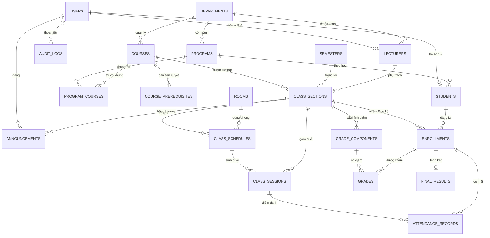

# Tài liệu Yêu cầu & Thiết kế Hệ thống Quản lý Trường học (SMS)

> Nguồn: `Tài liệu Yêu cầu & Thiết kế Hệ thống Quản lý Trường học (SMS).docx` (chuyển sang Markdown nguyên văn). Các điều chỉnh sau review nằm ở [review-notes.md](review-notes.md).

*Phiên bản 1.0 · 02/11/2026 · Trạng thái: bản nháp để review · Stack: Laravel · MySQL 8 · Docker*

## 1. Giới thiệu

### 1.1 Mục đích

Tài liệu mô tả yêu cầu, các actor, mô hình dữ liệu (ERD), kiến trúc và các module của hệ thống **Quản lý Trường học (SMS – School Management System)**. Đây là cơ sở để thiết kế, lập trình, kiểm thử và viết báo cáo đồ án. Các quyết định kiến trúc được rút ra từ báo cáo nghiên cứu 5 repo mã nguồn mở (modular monolith, Service layer, Spatie Permission, Docker Compose, Feature test).

### 1.2 Giả định

- Mô hình đào tạo **tín chỉ** (đại học/cao đẳng): sinh viên đăng ký **lớp học phần** theo từng học kỳ, vì vậy dùng thuật ngữ *Lecturer* và *Student*.

- Single-tenant (một cơ sở đào tạo), giao diện mặc định tiếng Việt.

- Ba actor người dùng: **Admin, Lecturer, Student**. Phụ huynh, kế toán, thủ thư không thuộc phạm vi.

- Điểm thang 10, quy đổi sang điểm chữ và thang 4.

### 1.3 Phạm vi

| Trong phạm vi                                                                                                                                            | Ngoài phạm vi (có thể mở rộng sau)                                                                                   |
|----------------------------------------------------------------------------------------------------------------------------------------------------------|----------------------------------------------------------------------------------------------------------------------|
| Tài khoản và phân quyền, cấu trúc đào tạo, mở lớp học phần, đăng ký học phần, thời khóa biểu, điểm danh, chấm điểm và GPA, thông báo, báo cáo, audit log | Học phí và thanh toán online, thư viện, ký túc xá, LMS (bài giảng, nộp bài), tuyển sinh, app mobile native, đa cơ sở |

### 1.4 Thuật ngữ

| Thuật ngữ                    | Ý nghĩa                                                                                        |
|------------------------------|------------------------------------------------------------------------------------------------|
| Học phần (Course)            | Môn học trong chương trình đào tạo, có số tín chỉ. Ví dụ: CS101 – Nhập môn lập trình           |
| Lớp học phần (Class Section) | Một lần mở học phần trong một học kỳ, do một giảng viên phụ trách, có sĩ số tối đa và lịch học |
| Học kỳ (Semester)            | Khoảng thời gian đào tạo, có thời hạn đăng ký học phần                                         |
| Khung chương trình           | Danh sách học phần thuộc một ngành, kèm học kỳ gợi ý và bắt buộc/tự chọn                       |
| Thành phần điểm              | Cột điểm của lớp (chuyên cần, giữa kỳ, cuối kỳ...) kèm trọng số                                |
| GPA                          | Điểm trung bình tích lũy tính theo tín chỉ                                                     |

## 2. Actor

### 2.1 Tổng quan

| Actor                                            | Mô tả                                    | Mục tiêu chính                                                           | Phạm vi dữ liệu                 |
|--------------------------------------------------|------------------------------------------|--------------------------------------------------------------------------|---------------------------------|
| **Admin**                                        | Cán bộ phòng đào tạo / quản trị hệ thống | Thiết lập cấu trúc đào tạo, quản lý tài khoản, mở lớp, giám sát hệ thống | Toàn hệ thống                   |
| **Lecturer**                                     | Giảng viên                               | Quản lý lớp được phân công: điểm danh, chấm điểm, thông báo              | Chỉ lớp học phần mình phụ trách |
| **Student**                                      | Sinh viên                                | Đăng ký học phần, xem lịch học, chuyên cần, điểm, thông báo              | Chỉ dữ liệu của chính mình      |
| Actor phụ: Scheduler / Queue Worker, Mail Server | Tác nhân hệ thống                        | Sinh buổi học, gửi email thông báo, nhắc hạn, tính lại GPA               | Chạy nền                        |

### 2.2 Admin

- **Vai trò:** nắm cấu hình nền; mọi dữ liệu dùng chung (khoa, ngành, học phần, học kỳ, phòng) do Admin tạo.

- **Use case chính:** quản lý tài khoản (tạo, import CSV, khóa/mở, reset mật khẩu, gán role); quản lý cấu trúc đào tạo; tạo học kỳ và mở/đóng đợt đăng ký; tạo lớp học phần, phân công giảng viên, xếp phòng và lịch; mở khóa điểm khi có yêu cầu; xem báo cáo và audit log.

- **Ràng buộc:** mọi thao tác nhạy cảm (đổi role, mở khóa điểm, xóa dữ liệu) phải ghi audit log. Chỉ **Super Admin** (permission roles.manage) được tạo/sửa Admin khác.

### 2.3 Lecturer

- **Vai trò:** trực tiếp giảng dạy và tạo ra dữ liệu học vụ (điểm danh, điểm).

- **Use case chính:** xem danh sách lớp được phân công và danh sách sinh viên; xem lịch dạy; điểm danh từng buổi; cấu hình thành phần điểm; nhập/sửa điểm; công bố (khóa) điểm; đăng thông báo cho lớp; xuất danh sách và bảng điểm lớp.

- **Ràng buộc:** chỉ thao tác trên lớp có lecturer_id là mình (kiểm tra bằng Policy); không sửa điểm sau khi đã khóa; không chỉnh hồ sơ học vụ của sinh viên.

### 2.4 Student

- **Vai trò:** nhóm người dùng đông nhất, chủ yếu đọc dữ liệu của chính mình và thực hiện đăng ký học phần.

- **Use case chính:** xem/sửa hồ sơ (chỉ các trường cho phép như SĐT, địa chỉ); xem khung chương trình; đăng ký/hủy học phần trong thời hạn; xem thời khóa biểu tuần; xem chuyên cần từng lớp; xem điểm thành phần, điểm tổng kết, GPA sau khi giảng viên công bố; đọc thông báo; xuất bảng điểm cá nhân.

- **Ràng buộc:** chỉ đăng ký khi đợt đăng ký đang mở, đủ điều kiện tiên quyết, không trùng lịch, không vượt giới hạn tín chỉ; không xem được dữ liệu của sinh viên khác (lỗi IDOR phải được chặn bằng Policy).

### 2.5 Ma trận phân quyền

Ký hiệu: C = tạo, R = xem, U = sửa, D = xóa, – = không có quyền.

| Chức năng                            | Admin           | Lecturer                           | Student                       |
|--------------------------------------|-----------------|------------------------------------|-------------------------------|
| Tài khoản người dùng                 | CRUD            | –                                  | –                             |
| Hồ sơ cá nhân                        | R tất cả, U     | R, U (của mình, giới hạn)          | R, U (của mình, giới hạn)     |
| Khoa, ngành, học phần, phòng, học kỳ | CRUD            | R                                  | R                             |
| Lớp học phần                         | CRUD            | R (lớp mình)                       | R (lớp đang mở)               |
| Đăng ký học phần                     | R, hủy hộ       | R (DS lớp mình)                    | C, D, R (của mình)            |
| Thời khóa biểu                       | R tất cả        | R (của mình)                       | R (của mình)                  |
| Điểm danh                            | R, sửa có log   | C, R, U (lớp mình)                 | R (của mình)                  |
| Thành phần điểm và điểm              | R, mở khóa      | C, R, U (lớp mình, trước khi khóa) | R (của mình, sau khi công bố) |
| Thông báo                            | CRUD            | CRUD (lớp mình)                    | R                             |
| Báo cáo và thống kê                  | R toàn hệ thống | R (lớp mình)                       | R (bảng điểm của mình)        |
| Audit log                            | R               | –                                  | –                             |

## 3. Yêu cầu chức năng

Ưu tiên: **M** = Must (Phase 1), **S** = Should (Phase 2), **C** = Could (nếu còn thời gian).

### 3.1 Xác thực và tài khoản (AUTH)

| ID         | Yêu cầu                                                  | Actor             | Ưu tiên |
|------------|----------------------------------------------------------|-------------------|---------|
| FR-AUTH-01 | Đăng nhập bằng email hoặc mã số + mật khẩu               | Tất cả            | M       |
| FR-AUTH-02 | Đăng xuất; session hết hạn sau thời gian không hoạt động | Tất cả            | M       |
| FR-AUTH-03 | Quên/đặt lại mật khẩu qua email (token có hạn)           | Tất cả            | M       |
| FR-AUTH-04 | Bắt buộc đổi mật khẩu ở lần đăng nhập đầu                | Lecturer, Student | S       |
| FR-AUTH-05 | Khóa tạm tài khoản sau 5 lần đăng nhập sai (rate limit)  | Tất cả            | S       |
| FR-AUTH-06 | Xem và cập nhật hồ sơ cá nhân, đổi mật khẩu              | Tất cả            | M       |

### 3.2 Quản lý người dùng (USER)

| ID         | Yêu cầu                                                                    | Actor | Ưu tiên |
|------------|----------------------------------------------------------------------------|-------|---------|
| FR-USER-01 | CRUD tài khoản, gán role, khóa/mở khóa                                     | Admin | M       |
| FR-USER-02 | Tạo hồ sơ sinh viên (mã SV, ngành, khóa) và hồ sơ giảng viên (mã GV, khoa) | Admin | M       |
| FR-USER-03 | Import danh sách sinh viên/giảng viên từ CSV/Excel, báo lỗi theo dòng      | Admin | S       |
| FR-USER-04 | Reset mật khẩu hộ người dùng                                               | Admin | M       |
| FR-USER-05 | Tìm kiếm, lọc, phân trang danh sách người dùng                             | Admin | M       |

### 3.3 Cấu trúc đào tạo (ACAD)

| ID         | Yêu cầu                                                                         | Actor | Ưu tiên |
|------------|---------------------------------------------------------------------------------|-------|---------|
| FR-ACAD-01 | CRUD khoa, ngành                                                                | Admin | M       |
| FR-ACAD-02 | CRUD học phần (mã, tên, số tín chỉ) và điều kiện tiên quyết                     | Admin | M       |
| FR-ACAD-03 | Quản lý khung chương trình của ngành (học phần, học kỳ gợi ý, bắt buộc/tự chọn) | Admin | S       |
| FR-ACAD-04 | CRUD học kỳ, đặt thời hạn mở/đóng đăng ký                                       | Admin | M       |
| FR-ACAD-05 | CRUD phòng học (mã, tòa nhà, sức chứa)                                          | Admin | M       |

### 3.4 Lớp học phần và lịch (CLS)

| ID        | Yêu cầu                                                        | Actor    | Ưu tiên |
|-----------|----------------------------------------------------------------|----------|---------|
| FR-CLS-01 | Tạo lớp học phần: học phần, học kỳ, giảng viên, sĩ số tối đa   | Admin    | M       |
| FR-CLS-02 | Khai báo lịch học hằng tuần (thứ, tiết, phòng, khoảng ngày)    | Admin    | M       |
| FR-CLS-03 | Phát hiện xung đột lịch của phòng và giảng viên khi lưu        | Admin    | M       |
| FR-CLS-04 | Tự sinh các buổi học (class sessions) từ lịch                  | Hệ thống | M       |
| FR-CLS-05 | Chuyển trạng thái lớp: nháp → mở đăng ký → đang học → kết thúc | Admin    | M       |

### 3.5 Đăng ký học phần (ENR)

| ID        | Yêu cầu                                                                            | Actor    | Ưu tiên |
|-----------|------------------------------------------------------------------------------------|----------|---------|
| FR-ENR-01 | Xem danh sách lớp đang mở của học kỳ, lọc theo học phần/ngành                      | Student  | M       |
| FR-ENR-02 | Đăng ký lớp: kiểm tra đợt đăng ký, sĩ số, tiên quyết, trùng lịch, giới hạn tín chỉ | Student  | M       |
| FR-ENR-03 | Hủy đăng ký trước hạn rút                                                          | Student  | M       |
| FR-ENR-04 | Chống vượt sĩ số khi nhiều sinh viên đăng ký đồng thời (khóa dòng + transaction)   | Hệ thống | M       |
| FR-ENR-05 | Admin thêm/hủy đăng ký hộ sinh viên (ngoại lệ có ghi log)                          | Admin    | S       |
| FR-ENR-06 | Gửi email xác nhận đăng ký (queue)                                                 | Hệ thống | C       |

### 3.6 Thời khóa biểu (TT)

| ID       | Yêu cầu                                           | Actor             | Ưu tiên |
|----------|---------------------------------------------------|-------------------|---------|
| FR-TT-01 | Xem thời khóa biểu tuần (theo tuần, học kỳ)       | Student, Lecturer | M       |
| FR-TT-02 | Xem lịch sử dụng phòng, lọc theo phòng/giảng viên | Admin             | S       |
| FR-TT-03 | Xuất thời khóa biểu ra PDF/iCal                   | Student, Lecturer | C       |

### 3.7 Điểm danh (ATT)

| ID        | Yêu cầu                                               | Actor           | Ưu tiên |
|-----------|-------------------------------------------------------|-----------------|---------|
| FR-ATT-01 | Điểm danh từng buổi: có mặt / vắng / muộn / có phép   | Lecturer        | M       |
| FR-ATT-02 | Sinh viên xem chuyên cần theo lớp, số buổi vắng       | Student         | M       |
| FR-ATT-03 | Cảnh báo khi vắng vượt ngưỡng (mặc định 20% số buổi)  | Hệ thống        | S       |
| FR-ATT-04 | Sửa điểm danh sau khi chốt phải có lý do và ghi audit | Lecturer, Admin | S       |

### 3.8 Điểm và kết quả (GRD)

| ID        | Yêu cầu                                                                 | Actor             | Ưu tiên |
|-----------|-------------------------------------------------------------------------|-------------------|---------|
| FR-GRD-01 | Cấu hình thành phần điểm cho lớp, tổng trọng số = 100%                  | Lecturer          | M       |
| FR-GRD-02 | Nhập/sửa điểm thành phần cho từng sinh viên (nhập tay, import Excel)    | Lecturer          | M       |
| FR-GRD-03 | Tự tính điểm tổng kết (thang 10), điểm chữ, điểm thang 4, đạt/không đạt | Hệ thống          | M       |
| FR-GRD-04 | Công bố (khóa) điểm: sinh viên chỉ thấy sau khi công bố                 | Lecturer          | M       |
| FR-GRD-05 | Admin mở khóa điểm kèm lý do; mọi thay đổi ghi audit                    | Admin             | M       |
| FR-GRD-06 | Sinh viên xem bảng điểm theo học kỳ và GPA học kỳ/tích lũy              | Student           | M       |
| FR-GRD-07 | Xuất bảng điểm cá nhân/lớp ra PDF/Excel                                 | Student, Lecturer | S       |

### 3.9 Thông báo (ANN)

| ID        | Yêu cầu                                                        | Actor             | Ưu tiên |
|-----------|----------------------------------------------------------------|-------------------|---------|
| FR-ANN-01 | Đăng thông báo với phạm vi: toàn trường hoặc theo lớp học phần | Admin, Lecturer   | M       |
| FR-ANN-02 | Hiển thị thông báo mới, đánh dấu đã đọc, ghim                  | Student, Lecturer | S       |
| FR-ANN-03 | Gửi email/notification khi có thông báo mới (queue)            | Hệ thống          | C       |

### 3.10 Báo cáo và audit (RPT)

| ID        | Yêu cầu                                                                                                    | Actor           | Ưu tiên |
|-----------|------------------------------------------------------------------------------------------------------------|-----------------|---------|
| FR-RPT-01 | Dashboard theo role (Admin: số lượng user/lớp/đăng ký; Lecturer: lớp đang dạy; Student: lịch hôm nay, GPA) | Tất cả          | S       |
| FR-RPT-02 | Thống kê phổ điểm, tỷ lệ đạt, chuyên cần theo lớp/học phần                                                 | Admin, Lecturer | S       |
| FR-RPT-03 | Xem audit log, lọc theo người dùng, hành động, thời gian                                                   | Admin           | M       |

## 4. Mô hình dữ liệu (ERD)

### 4.1 Danh sách thực thể

| Nhóm                    | Bảng                                                                             | Vai trò                                               |
|-------------------------|----------------------------------------------------------------------------------|-------------------------------------------------------|
| Định danh và phân quyền | users                                                                            | Tài khoản đăng nhập dùng chung cho cả 3 actor         |
|                         | roles, permissions, model_has_roles, model_has_permissions, role_has_permissions | Bảng chuẩn của Spatie Permission (không vẽ trong ERD) |
|                         | students                                                                         | Hồ sơ sinh viên (quan hệ 1–1 với users)               |
|                         | lecturers                                                                        | Hồ sơ giảng viên (quan hệ 1–1 với users)              |
| Cấu trúc đào tạo        | departments                                                                      | Khoa                                                  |
|                         | programs                                                                         | Ngành đào tạo                                         |
|                         | courses                                                                          | Học phần                                              |
|                         | course_prerequisites                                                             | Điều kiện tiên quyết (học phần – học phần)            |
|                         | program_courses                                                                  | Khung chương trình (ngành – học phần)                 |
|                         | semesters                                                                        | Học kỳ và thời hạn đăng ký                            |
|                         | rooms                                                                            | Phòng học                                             |
| Giảng dạy               | class_sections                                                                   | Lớp học phần                                          |
|                         | class_schedules                                                                  | Lịch học lặp hằng tuần                                |
|                         | class_sessions                                                                   | Từng buổi học cụ thể (dùng để điểm danh)              |
| Đăng ký                 | enrollments                                                                      | Sinh viên đăng ký lớp học phần — **bảng trung tâm**   |
| Điểm danh               | attendance_records                                                               | Trạng thái có mặt của sinh viên theo buổi             |
| Điểm                    | grade_components                                                                 | Thành phần điểm và trọng số của lớp                   |
|                         | grades                                                                           | Điểm từng thành phần của từng sinh viên               |
|                         | final_results                                                                    | Kết quả tổng kết (điểm 10, chữ, thang 4, đạt/không)   |
| Giao tiếp               | announcements                                                                    | Thông báo toàn trường hoặc theo lớp                   |
| Hệ thống                | audit_logs                                                                       | Nhật ký thay đổi dữ liệu nhạy cảm                     |
|                         | notifications, jobs, failed_jobs                                                 | Bảng sẵn có của Laravel                               |

### 4.2 Sơ đồ ERD (Mermaid)

Dán đoạn dưới vào mermaid.live hoặc công cụ hỗ trợ Mermaid để xem hình. Thuộc tính chi tiết từng bảng nằm ở phần Từ điển dữ liệu.



### 4.3 Các quyết định thiết kế dữ liệu quan trọng

- **users + bảng hồ sơ riêng (students, lecturers)** thay vì một bảng users chứa mọi cột: dữ liệu đặc thù từng vai trò không làm bảng users phình ra; Admin chỉ cần dòng trong users. Role lưu bằng Spatie, không dùng cột type cố định (anti-pattern thấy ở OfficialAshpak/Unifiedtransform).

- **enrollments là trung tâm:** điểm danh, điểm thành phần và kết quả đều tham chiếu enrollment_id thay vì cặp (student, class), nên rút đăng ký thì toàn bộ dữ liệu liên quan nhất quán.

- **Tách class_schedules (lịch lặp) và class_sessions (buổi cụ thể):** lịch dùng để phát hiện xung đột phòng/giảng viên và hiển thị thời khóa biểu; buổi cụ thể mới là đơn vị điểm danh, cho phép nghỉ bù, đổi phòng từng buổi.

- **Điểm chia 3 bảng:** grade_components (cấu hình của lớp), grades (điểm thô), final_results (kết quả đã tính, có published_at/locked_at). Tính lại được khi đổi điểm và công bố có kiểm soát.

- **Ràng buộc toàn vẹn:** FK đầy đủ; unique (student_id, class_section_id) ở enrollments, (class_session_id, enrollment_id) ở attendance_records, (enrollment_id, grade_component_id) ở grades, (course_id, semester_id, code) ở class_sections.

- **Số đếm phi chuẩn:** class_sections.enrolled_count được cập nhật trong transaction cùng việc đăng ký (khóa dòng bằng lockForUpdate) để kiểm tra sĩ số nhanh và an toàn khi đồng thời.

- **Soft delete** cho users, courses, class_sections để giữ lịch sử; dữ liệu học vụ (enrollments, grades) không xóa cứng.

## 5. Kiến trúc hệ thống

### 5.1 Quyết định kiến trúc

**Modular Monolith** trên Laravel, mỗi module tổ chức theo tầng (layered):

Route → Middleware (role/permission) → Controller (mỏng) → FormRequest (validate) → Policy (authorize) → Service (nghiệp vụ, transaction) → Eloquent Model → MySQL → View Blade hoặc JsonResource

Công nghệ: Laravel (PHP 8.3+), MySQL 8, Redis (cache, queue, session), Nginx + PHP-FPM, Docker Compose, Spatie Permission, Blade + Bootstrap 5 (+ Alpine.js), PHPUnit/Pest, GitHub Actions.

### 5.2 Tầng và trách nhiệm

| Tầng                   | Trách nhiệm                                                                             | Không được làm                          |
|------------------------|-----------------------------------------------------------------------------------------|-----------------------------------------|
| Controller             | Nhận request, gọi Service, trả response                                                 | Chứa logic nghiệp vụ, truy vấn phức tạp |
| FormRequest            | Validate và chuẩn hóa input                                                             | Ghi DB                                  |
| Policy                 | Kiểm tra quyền theo đối tượng (lecturer chỉ lớp của mình, student chỉ dữ liệu của mình) | Chứa quy tắc nghiệp vụ                  |
| Service                | Quy tắc nghiệp vụ, transaction, phát Event                                              | Biết về HTTP (Request/Response)         |
| Model (Eloquent)       | Quan hệ, scope, cast, accessor                                                          | Chứa quy trình nhiều bước               |
| Event / Listener / Job | Tác vụ phụ: email, audit, tính lại GPA, import                                          | Chặn luồng chính của người dùng         |

**Về Repository:** không bọc Repository cho mọi model (Eloquent đã là lớp truy cập dữ liệu, bọc thêm chỉ tăng boilerplate cho đồ án). Chỉ dùng lớp **Query/Repository ở truy vấn phức tạp** như thời khóa biểu, báo cáo, tính GPA.

### 5.3 So sánh các phương án kiến trúc

| Tiêu chí                           | MVC "fat controller"    | **Modular monolith (chọn)**      | Microservices                          | SPA + API tách (React/Vue + Laravel API) |
|------------------------------------|-------------------------|----------------------------------|----------------------------------------|------------------------------------------|
| Tốc độ phát triển (team nhỏ)       | Nhanh lúc đầu, chậm dần | Tốt                              | Chậm                                   | Trung bình (2 codebase)                  |
| Toàn vẹn giao dịch (đăng ký, điểm) | Tốt                     | Tốt (1 DB, 1 transaction)        | Khó (giao dịch phân tán)               | Tốt                                      |
| Bảo trì và kiểm thử                | Kém                     | Tốt                              | Tốt nhưng tốn chi phí                  | Tốt                                      |
| Chi phí vận hành, Docker           | Thấp                    | Thấp                             | Cao (nhiều service, gateway, giám sát) | Trung bình                               |
| Mở rộng về sau                     | Kém                     | Có thể tách module thành service | Rất tốt                                | Tốt                                      |
| Phù hợp đồ án 1–5 người            | Tạm được                | **Rất phù hợp**                  | Không                                  | Tạm được                                 |

### 5.4 Vì sao chọn modular monolith

1.  **Dữ liệu gắn chặt:** đăng ký học phần, điểm danh và điểm đều xoay quanh enrollments; cần ACID transaction và khóa dòng để chống vượt sĩ số. Một DB duy nhất đơn giản hơn nhiều so với saga hay giao dịch phân tán.

2.  **Quy mô vừa phải:** hàng nghìn người dùng, đỉnh tải khi mở đăng ký vẫn xử lý được bằng một ứng dụng + Redis + queue; microservices là thiết kế thừa.

3.  **Team nhỏ, thời gian có hạn:** một codebase, một pipeline CI, một docker-compose.yml.

4.  **Tránh anti-pattern đã quan sát trong nghiên cứu:** Unifiedtransform và OfficialAshpak đặt logic trong Controller/Model và hardcode role; mô hình module + Service + Spatie của tanzibhossain là hướng đáng theo.

5.  **Đường lùi để mở rộng:** ranh giới module rõ (giao tiếp qua Service/Event) cho phép tách thành service riêng sau này nếu thật sự cần.

### 5.5 Vì sao không chọn các phương án khác

- **Fat controller MVC:** nhanh lúc đầu nhưng logic đăng ký và tính điểm rải rác, khó kiểm thử — đúng anti-pattern đã cảnh báo.

- **Microservices:** thừa với quy mô này; đăng ký học phần cần giao dịch chặt; phải thêm gateway, service discovery, tracing — chi phí lớn, lợi ích thấp.

- **SPA + API tách ngay từ đầu:** hai codebase, thêm CORS/CSRF/token, tốn thời gian giao diện trong khi giá trị đồ án nằm ở nghiệp vụ. Thay vào đó: Phase 1 dùng Blade; vì Service layer dùng chung nên Phase 2 có thể mở /api/v1 (Sanctum) mà không viết lại logic.

- **Repository cho mọi model:** tăng boilerplate không cần thiết (xem 5.2).

- **Tự viết RBAC / role cứng:** khó mở rộng, dễ sai sót bảo mật; dùng Spatie Permission.

### 5.6 Cấu trúc thư mục

```text
app/
Modules/
Identity/ # Auth, User, Role
Academic/ # Department, Program, Course, Semester, Room
Teaching/ # ClassSection, Schedule, Session, Timetable
Enrollment/
Attendance/
Grading/
Announcement/
Reporting/ # Dashboard, Report, AuditLog
(mỗi module gồm:)
Controllers/ Requests/ Policies/ Services/ Models/ Resources/
Events/ Listeners/ Jobs/ Queries/
Database/{Migrations,Seeders,Factories}
Routes/{web.php,api.php}
Providers/<Module>ServiceProvider.php
Shared/ # Enums, Traits, Exceptions, Auditable
tests/Feature/<Module> tests/Unit/<Module>
docker/ # nginx, php, mysql
```

**Quy tắc ranh giới:** module A không truy vấn trực tiếp bảng của module B; gọi qua Service hoặc lắng nghe Event. Ngoại lệ có chủ đích: quan hệ Eloquent tới các model lõi (User, Course, ClassSection).

### 5.7 Hạ tầng Docker Compose

| Service          | Image                           | Vai trò                                      |
|------------------|---------------------------------|----------------------------------------------|
| nginx            | nginx:stable                    | Reverse proxy, file tĩnh                     |
| app              | php:8.3-fpm (multi-stage build) | Chạy Laravel                                 |
| queue            | cùng image app                  | php artisan queue:work (mail, audit, import) |
| scheduler        | cùng image app                  | schedule:work (sinh buổi học, nhắc hạn)      |
| mysql            | mysql:8                         | CSDL, volume đặt tên db_data                 |
| redis            | redis:7                         | Cache, session, queue                        |
| mailpit (dev)    | axllent/mailpit                 | Bắt email khi phát triển                     |
| phpmyadmin (dev) | phpmyadmin                      | Xem DB                                       |

Cấu hình qua .env; mysql có healthcheck, app chờ healthy rồi mới chạy migrate --seed; đặt restart policy; tắt debug khi deploy.

### 5.8 Bảo mật và phân quyền

- Spatie Permission: role admin, lecturer, student; permission dạng resource.action (ví dụ grades.publish). Guard web (session) cho Blade, sanctum cho API ở Phase 2.

- **Hai lớp kiểm tra:** (1) middleware role/permission ở route; (2) **Policy theo đối tượng** (lecturer chỉ lớp của mình, student chỉ bản ghi của mình) để chặn IDOR.

- Hash mật khẩu bằng bcrypt/argon2, CSRF, rate limit đăng nhập, validate bằng FormRequest, escape output Blade, bảo vệ mass-assignment.

- Thay đổi nhạy cảm (điểm, role, mở khóa, sửa điểm danh) ghi audit_logs.

### 5.9 Thành phần xuyên suốt

- **Event:** EnrollmentCreated, EnrollmentDropped, GradesPublished, AttendanceFinalized → Listener gửi mail, ghi audit, tính lại GPA.

- **Queue:** mail, import Excel, xuất báo cáo lớn.

- **Cache:** danh mục khoa/ngành/học phần; xóa cache bằng Observer khi dữ liệu đổi.

- **Enum PHP** cho trạng thái (trạng thái lớp, đăng ký, điểm danh) thay chuỗi tự do.

## 6. Các module của hệ thống

### 6.1 Tổng quan và phụ thuộc

| Module            | Mục đích                                      | Thực thể sở hữu                                                                         | Actor chính              | Phase |
|-------------------|-----------------------------------------------|-----------------------------------------------------------------------------------------|--------------------------|-------|
| Identity          | Xác thực, tài khoản, hồ sơ, role/permission   | users, students, lecturers                                                              | Tất cả                   | 1     |
| Academic          | Cấu trúc đào tạo và học kỳ                    | departments, programs, courses, course_prerequisites, program_courses, semesters, rooms | Admin                    | 1     |
| Teaching          | Lớp học phần, lịch, buổi học, thời khóa biểu  | class_sections, class_schedules, class_sessions                                         | Admin, Lecturer, Student | 1     |
| Enrollment        | Đăng ký/hủy học phần, kiểm tra điều kiện      | enrollments                                                                             | Student, Admin           | 1     |
| Attendance        | Điểm danh và thống kê chuyên cần              | attendance_records                                                                      | Lecturer, Student        | 1     |
| Grading           | Thành phần điểm, nhập điểm, tính GPA, công bố | grade_components, grades, final_results                                                 | Lecturer, Student, Admin | 1     |
| Announcement      | Thông báo toàn trường và theo lớp             | announcements                                                                           | Admin, Lecturer, Student | 1–2   |
| Reporting & Audit | Dashboard, báo cáo, xuất file, nhật ký        | audit_logs (đọc dữ liệu các module khác)                                                | Admin                    | 2     |

**Chiều phụ thuộc (module bên phải được module bên trái gọi):** Identity ← Academic ← Teaching ← Enrollment ← {Attendance, Grading}. Announcement dùng Teaching và Enrollment để xác định người nhận. Reporting chỉ đọc từ mọi module. Không có phụ thuộc vòng; khi cần chiều ngược (ví dụ Enrollment cần biết sinh viên đã đạt học phần tiên quyết chưa) thì gọi qua một **contract/interface** do Grading cung cấp (PassedCoursesProvider) thay vì truy vấn trực tiếp bảng final_results.

### 6.2 Identity (Xác thực và người dùng)

- **Trách nhiệm:** đăng nhập/đăng xuất, đặt lại mật khẩu, CRUD tài khoản, hồ sơ sinh viên/giảng viên, gán role và permission.

- **Thành phần chính:** AuthController, UserController, ProfileController; UserService (createStudent, createLecturer, deactivate, importFromFile); UserPolicy; RolePermissionSeeder (tạo admin, lecturer, student và permission).

- **Quy tắc quan trọng:** email và mã số (mã SV/GV) là duy nhất; tạo users và hồ sơ trong cùng một transaction; tài khoản bị khóa không đăng nhập được; không xóa cứng người dùng đã có dữ liệu học vụ; mật khẩu tạm gửi qua email và buộc đổi ở lần đăng nhập đầu.

- **Event phát ra:** UserCreated, PasswordResetRequested.

- **Kiểm thử trọng tâm:** đăng nhập đúng/sai, khóa tài khoản, Student không truy cập được route Admin, import CSV có dòng lỗi.

### 6.3 Academic (Cấu trúc đào tạo)

- **Trách nhiệm:** quản lý khoa, ngành, học phần, tiên quyết, khung chương trình, học kỳ và phòng học.

- **Thành phần chính:** DepartmentService, ProgramService, CourseService (setPrerequisites có phát hiện vòng lặp), SemesterService (openRegistration, closeRegistration, isRegistrationOpen), RoomService; cache danh mục kèm Observer.

- **Quy tắc quan trọng:** điều kiện tiên quyết không được tạo vòng (A cần B, B cần A); không xóa học phần đã có lớp mở; tại một thời điểm chỉ có một học kỳ ở trạng thái *current*; registration_open_at \< registration_close_at; mã khoa/ngành/học phần/phòng duy nhất.

- **Vì sao tách riêng:** đây là dữ liệu danh mục thay đổi chậm, đọc nhiều, nên cache tốt và là nền cho mọi module phía sau.

### 6.4 Teaching (Lớp học phần, lịch, thời khóa biểu)

- **Trách nhiệm:** tạo lớp học phần, gán giảng viên, khai báo lịch, sinh buổi học, truy vấn thời khóa biểu.

- **Thành phần chính:** ClassSectionService (create, assignLecturer, changeStatus); ScheduleService (detectConflicts, generateSessions); TimetableQuery (forStudent, forLecturer, forRoom); ClassSectionPolicy.

- **Trạng thái lớp:** draft → open → in_progress → finished → grades_published (chỉ chuyển tiến, mỗi bước kiểm tra điều kiện; xem mục 9).

- **Quy tắc quan trọng:** hai lịch xung đột khi trùng phòng hoặc trùng giảng viên, cùng thứ, giao nhau về tiết và giao nhau về khoảng ngày; sĩ số tối đa không nên vượt sức chứa phòng (cảnh báo); sinh buổi học mới khi đổi lịch phải giữ lại các buổi đã có điểm danh.

- **Thành phần dễ sai nhất:** phát hiện xung đột (nên có test cho biên: tiết liền kề không tính là trùng).

### 6.5 Enrollment (Đăng ký học phần)

- **Trách nhiệm:** đăng ký, hủy, Admin can thiệp ngoại lệ; đây là **module phức tạp và quan trọng nhất**.

- **Thành phần chính:** EnrollmentService (register, drop, adminOverride); EnrollmentRuleChecker chạy chuỗi rule độc lập, dễ thêm bớt: RegistrationWindowRule, DuplicateCourseRule, CapacityRule, PrerequisiteRule, ScheduleConflictRule, CreditLimitRule; EnrollmentPolicy.

- **Luồng register:** mở transaction → khóa dòng lớp (lockForUpdate) → chạy các rule → tạo enrollments (status registered) → tăng enrolled_count → commit → phát EnrollmentCreated (gửi mail qua queue).

- **Quy tắc quan trọng:** giới hạn tín chỉ mỗi học kỳ lấy từ cấu hình (ví dụ 14–24); chỉ hủy trước hạn rút; học lại tạo bản ghi mới, không ghi đè; Admin ghi đè rule phải có lý do và audit.

- **Kiểm thử trọng tâm:** hai request đồng thời vào lớp còn 1 chỗ chỉ một request thành công; mỗi rule có test riêng.

### 6.6 Attendance (Điểm danh)

- **Trách nhiệm:** giảng viên điểm danh theo buổi, sinh viên xem chuyên cần, cảnh báo vắng quá ngưỡng.

- **Thành phần chính:** AttendanceService (markSession ghi hàng loạt kiểu upsert, finalizeSession, summaryForEnrollment); AttendancePolicy; Listener CheckAbsenceThreshold.

- **Trạng thái điểm danh:** present, absent, late, excused.

- **Quy tắc quan trọng:** chỉ điểm danh buổi nằm trong cửa sổ cho phép (cấu hình, mặc định ±7 ngày); sau khi chốt buổi, mọi chỉnh sửa cần lý do và ghi audit; tỷ lệ vắng = số buổi absent (không tính excused) / số buổi đã diễn ra; vượt ngưỡng (mặc định 20%) phát AbsenceThresholdExceeded.

### 6.7 Grading (Điểm và kết quả)

- **Trách nhiệm:** cấu hình thành phần điểm, nhập điểm, tính điểm tổng kết và GPA, công bố/mở khóa.

- **Thành phần chính:** GradeComponentService (kiểm tra tổng trọng số = 100); GradeService (recordScores hàng loạt, importFromExcel); GradeCalculator (weightedTotal, toLetter, toGpa4); GpaCalculator (semesterGpa, cumulativeGpa); GradePublishService (publish, unlock kèm lý do); GradePolicy.

- **Công thức:** điểm tổng kết (thang 10) = Σ( điểm thành phần / điểm tối đa × 10 × trọng số% ). GPA = Σ(điểm thang 4 × số tín chỉ) / Σ số tín chỉ, chỉ tính học phần đã công bố.

- **Bảng quy đổi mẫu (cấu hình được):** 8.5–10 → A (4.0); 8.0–8.4 → B+ (3.5); 7.0–7.9 → B (3.0); 6.5–6.9 → C+ (2.5); 5.5–6.4 → C (2.0); 5.0–5.4 → D+ (1.5); 4.0–4.9 → D (1.0); dưới 4.0 → F (0, không đạt).

- **Quy tắc quan trọng:** điểm trong khoảng 0 đến điểm tối đa của thành phần; công bố thì khóa toàn bộ điểm của lớp, sinh viên chỉ thấy sau công bố; mở khóa chỉ Admin, bắt buộc lý do và audit, sau khi sửa phải công bố lại; học lại thì GPA lấy theo chính sách cấu hình (lần cao nhất hoặc lần gần nhất).

- **Event phát ra:** GradesPublished, GradesUnlocked → tính lại GPA, gửi thông báo, ghi audit.

### 6.8 Announcement (Thông báo)

- **Trách nhiệm:** đăng và phân phối thông báo.

- **Thành phần chính:** AnnouncementService (publish, resolveAudience); AnnouncementPolicy; Job SendAnnouncementNotification (dùng bảng notifications của Laravel).

- **Quy tắc quan trọng:** phạm vi all gửi mọi người dùng; phạm vi class_section chỉ gửi sinh viên đang có đăng ký registered trong lớp đó; Lecturer chỉ đăng cho lớp mình; hỗ trợ ghim và hẹn giờ đăng (published_at).

### 6.9 Reporting và Audit

- **Trách nhiệm:** dashboard theo role, báo cáo thống kê, xuất Excel/PDF, xem nhật ký.

- **Thành phần chính:** DashboardQuery cho từng role; GradeDistributionReport; AttendanceReport; ExportService; AuditLogger kèm trait Auditable và Listener ghi log; AuditLogController.

- **Quy tắc quan trọng:** module chỉ **đọc**, không ghi vào bảng của module khác; audit_logs là append-only (không cập nhật/xóa), lưu giá trị cũ/mới dạng JSON, IP, user agent; báo cáo lớn chạy qua queue và trả file khi xong.

## 7. Yêu cầu phi chức năng

| Nhóm               | Mã          | Yêu cầu                                                                    | Cách đáp ứng                                            |
|--------------------|-------------|----------------------------------------------------------------------------|---------------------------------------------------------|
| Bảo mật            | NFR-SEC-01  | Mật khẩu băm một chiều, không lưu plaintext                                | Hash::make (bcrypt/argon2)                              |
|                    | NFR-SEC-02  | Ngăn truy cập trái quyền (IDOR)                                            | Policy theo đối tượng + test cho từng role              |
|                    | NFR-SEC-03  | Chống CSRF, XSS, SQL injection, brute-force                                | CSRF token, escape Blade, Eloquent/binding, rate limit  |
|                    | NFR-SEC-04  | Thay đổi nhạy cảm truy vết được                                            | audit_logs append-only                                  |
| Hiệu năng          | NFR-PERF-01 | Trang thông thường phản hồi dưới 500 ms (p95) với 200 người dùng đồng thời | Index, eager loading, cache danh mục, Redis             |
|                    | NFR-PERF-02 | Đăng ký học phần chịu được đỉnh tải khi mở đợt                             | Transaction ngắn, khóa dòng, queue cho tác vụ phụ       |
| Toàn vẹn           | NFR-DATA-01 | Không vượt sĩ số, không trùng đăng ký                                      | lockForUpdate, unique index, kiểm tra trong transaction |
|                    | NFR-DATA-02 | Không mất dữ liệu học vụ                                                   | Soft delete, backup MySQL định kỳ                       |
| Khả dụng           | NFR-AVL-01  | Mục tiêu uptime 99% trong học kỳ                                           | Restart policy, healthcheck, giám sát log               |
| Bảo trì            | NFR-MNT-01  | Logic nghiệp vụ nằm ở Service, độ phủ test Service từ 70%                  | PHPUnit/Pest, CI chạy tự động                           |
|                    | NFR-MNT-02  | Code đồng nhất, phát hiện lỗi sớm                                          | Laravel Pint, Larastan, composer audit                  |
| Triển khai         | NFR-DEP-01  | Dựng môi trường bằng một lệnh                                              | docker compose up, migrate --seed tự động               |
| Khả dụng giao diện | NFR-UX-01   | Responsive, dùng được trên điện thoại                                      | Bootstrap 5; ưu tiên màn hình Student (lịch, điểm)      |
| Địa phương hóa     | NFR-I18N-01 | Tiếng Việt mặc định, định dạng ngày dd/mm/yyyy, múi giờ Asia/Ho_Chi_Minh   | Lang files, cấu hình app.timezone                       |

## 8. Từ điển dữ liệu

Quy ước: mọi bảng có id (bigint unsigned, PK) và created_at, updated_at trừ khi ghi khác; FK = khóa ngoại; *(U)* = unique. Cột trạng thái dùng PHP Enum ở tầng ứng dụng.

### 8.1 Định danh

- **users**: code (U, mã số đăng nhập), name, email (U), password, status (active/locked), must_change_password, email_verified_at, last_login_at, remember_token, deleted_at.

- **students**: user_id (FK, U), student_code (U), program_id (FK), cohort_year, date_of_birth, gender, phone, address, status (studying/suspended/graduated/dropped_out).

- **lecturers**: user_id (FK, U), lecturer_code (U), department_id (FK), academic_title, phone, office.

### 8.2 Cấu trúc đào tạo

- **departments**: code (U), name, description.

- **programs**: department_id (FK), code (U), name, total_credits_required, duration_years.

- **courses**: department_id (FK), code (U), name, credits, theory_periods, practice_periods, description, is_active, deleted_at.

- **course_prerequisites**: course_id (FK), prerequisite_course_id (FK); khóa chính ghép; ràng buộc course_id \<\> prerequisite_course_id.

- **program_courses**: program_id (FK), course_id (FK), suggested_semester_no, type (required/elective); unique (program_id, course_id).

- **semesters**: code (U, ví dụ 2026-1), name, academic_year, start_date, end_date, registration_open_at, registration_close_at, drop_deadline, min_credits, max_credits, is_current.

- **rooms**: code (U), building, capacity, type (lecture/lab), is_active.

### 8.3 Giảng dạy và đăng ký

- **class_sections**: course_id (FK), semester_id (FK), lecturer_id (FK, nullable cho tới khi phân công), code (ví dụ CS101.01), capacity, enrolled_count, status (draft/open/in_progress/finished/grades_published), deleted_at; unique (course_id, semester_id, code).

- **class_schedules**: class_section_id (FK), room_id (FK), day_of_week (1–7), start_period, end_period, start_date, end_date; index (room_id, day_of_week) để dò xung đột.

- **class_sessions**: class_section_id (FK), class_schedule_id (FK, nullable), session_no, session_date, start_period, end_period, room_id (FK), status (scheduled/held/cancelled); unique (class_section_id, session_no).

- **enrollments**: student_id (FK), class_section_id (FK), status (registered/dropped/completed), registered_at, dropped_at, registered_by (FK users, khi Admin đăng ký hộ), override_reason; unique (student_id, class_section_id).

### 8.4 Điểm danh và điểm

- **attendance_records**: class_session_id (FK), enrollment_id (FK), status (present/absent/late/excused), note, marked_by (FK users), marked_at; unique (class_session_id, enrollment_id).

- **grade_components**: class_section_id (FK), name, weight (decimal 5,2, tổng mỗi lớp = 100), max_score (mặc định 10), sort_order; unique (class_section_id, name).

- **grades**: enrollment_id (FK), grade_component_id (FK), score (decimal 5,2, nullable = chưa nhập), graded_by (FK users), graded_at; unique (enrollment_id, grade_component_id).

- **final_results**: enrollment_id (FK, U), total_score (thang 10), letter_grade, gpa_point (thang 4), is_passed, published_at, locked_at, unlocked_by (FK users), unlock_reason.

### 8.5 Giao tiếp và hệ thống

- **announcements**: author_id (FK users), class_section_id (FK, nullable), scope (all/class_section), title, body, is_pinned, published_at.

- **audit_logs** (chỉ có created_at, không sửa/xóa): user_id (FK, nullable), action, auditable_type, auditable_id, old_values (JSON), new_values (JSON), reason, ip_address, user_agent; index (auditable_type, auditable_id) và (user_id, created_at).

## 9. Trạng thái và quy tắc nghiệp vụ

### 9.1 Vòng đời lớp học phần

| Chuyển trạng thái           | Điều kiện                                                                             | Ai thực hiện         |
|-----------------------------|---------------------------------------------------------------------------------------|----------------------|
| draft → open                | Đã có giảng viên, ít nhất một lịch, không xung đột phòng/giảng viên, nằm trong học kỳ | Admin                |
| open → in_progress          | Đã qua hạn đóng đăng ký và đến ngày bắt đầu                                           | Scheduler hoặc Admin |
| in_progress → finished      | Đã qua ngày kết thúc lịch cuối                                                        | Scheduler hoặc Admin |
| finished → grades_published | Mọi sinh viên có đủ điểm thành phần, tổng trọng số = 100%                             | Lecturer             |
| grades_published → finished | Mở khóa điểm, bắt buộc lý do, ghi audit                                               | Admin                |

### 9.2 Vòng đời đăng ký

registered → dropped (trước hạn rút, giải phóng chỗ) và registered → completed (khi lớp công bố điểm). Bản ghi dropped được giữ lại để truy vết, không xóa.

### 9.3 Quy tắc nghiệp vụ chính

| Mã    | Quy tắc                                                                                                       |
|-------|---------------------------------------------------------------------------------------------------------------|
| BR-01 | Một sinh viên không đăng ký hai lớp của cùng một học phần trong cùng học kỳ                                   |
| BR-02 | Phải đã đạt (is_passed) các học phần tiên quyết mới được đăng ký                                              |
| BR-03 | Tổng tín chỉ đăng ký không vượt max_credits của học kỳ; thấp hơn min_credits thì cảnh báo khi hết hạn đăng ký |
| BR-04 | Các lớp sinh viên đăng ký không được trùng lịch (cùng thứ, giao nhau về tiết và khoảng ngày)                  |
| BR-05 | Lớp đầy không nhận thêm; enrolled_count không vượt capacity                                                   |
| BR-06 | Giảng viên và phòng học không được có hai lịch trùng nhau                                                     |
| BR-07 | Tổng trọng số thành phần điểm của lớp bằng 100% trước khi công bố                                             |
| BR-08 | Sau khi công bố, điểm bị khóa; chỉ Admin được mở khóa và phải nêu lý do                                       |
| BR-09 | Vắng vượt ngưỡng (mặc định 20%) thì phát cảnh báo cho sinh viên và giảng viên                                 |
| BR-10 | Mọi thay đổi về điểm, role, mở khóa điểm, sửa điểm danh đã chốt đều ghi audit                                 |

## 10. Kiểm thử và CI/CD

| Mức           | Phạm vi                   | Ví dụ trọng tâm                                                                                                                      |
|---------------|---------------------------|--------------------------------------------------------------------------------------------------------------------------------------|
| Unit          | Service, Calculator, Rule | GradeCalculator quy đổi điểm; từng EnrollmentRule; phát hiện xung đột lịch ở biên                                                    |
| Feature       | HTTP + DB cho từng module | Student đăng ký thành công/thất bại theo từng rule; Lecturer không sửa được lớp người khác; Student không xem được điểm chưa công bố |
| Concurrency   | Chống vượt sĩ số          | Hai tiến trình cùng đăng ký lớp còn một chỗ, chỉ một thành công                                                                      |
| Authorization | Ma trận 2.5               | Mỗi route được test với từng role (200/403)                                                                                          |

**Pipeline GitHub Actions:** cài dependency → Laravel Pint → Larastan → composer audit → chạy test trên dịch vụ MySQL → build Docker image (khi merge vào nhánh chính).

**Dữ liệu mẫu (seeders):** 1 Super Admin, vài Admin, khoảng 20 giảng viên, 300 sinh viên, 3 khoa, 6 ngành, 60 học phần, 2 học kỳ, 40 lớp học phần có lịch; dùng Factory để sinh nhanh phục vụ demo và test.

## 11. Lộ trình triển khai

| Giai đoạn                           | Nội dung                                                               | Đầu ra kiểm chứng được                               |
|-------------------------------------|------------------------------------------------------------------------|------------------------------------------------------|
| Sprint 0 – Nền tảng                 | Repo, Docker Compose, Laravel, Spatie, layout Blade, CI khung          | docker compose up chạy, đăng nhập được, CI xanh      |
| Sprint 1 – Identity + Academic      | CRUD người dùng và hồ sơ, khoa/ngành/học phần/học kỳ/phòng, seeders    | Admin tạo được dữ liệu nền; test phân quyền          |
| Sprint 2 – Teaching                 | Lớp học phần, lịch, phát hiện xung đột, sinh buổi học, thời khóa biểu  | Student/Lecturer xem được thời khóa biểu tuần        |
| Sprint 3 – Enrollment               | Chuỗi rule, transaction + khóa dòng, hủy đăng ký                       | Test đồng thời đạt; đăng ký đúng mọi rule            |
| Sprint 4 – Attendance + Grading     | Điểm danh, thành phần điểm, tính điểm/GPA, công bố và mở khóa          | Luồng từ nhập điểm tới Student xem GPA chạy trọn vẹn |
| Sprint 5 – Announcement + Reporting | Thông báo, dashboard, xuất Excel/PDF, audit log, README, báo cáo đồ án | Bản demo hoàn chỉnh theo kịch bản 3 actor            |

Mỗi sprint 1–2 tuần tùy quỹ thời gian; ưu tiên hoàn thành mục **M** trước, mục **S** và **C** làm khi còn thời gian.

## 12. Rủi ro và giảm thiểu

| Rủi ro                                           | Giảm thiểu                                                                       |
|--------------------------------------------------|----------------------------------------------------------------------------------|
| Phạm vi phình to (học phí, thư viện, LMS...)     | Giữ nguyên mục 1.3; mọi yêu cầu mới phải đánh dấu M/S/C và đẩy ra Phase sau      |
| Xung đột lịch và đăng ký phức tạp, dễ sai biên   | Tách thành rule/service nhỏ, viết test biên trước khi viết giao diện             |
| Đăng ký đồng thời vượt sĩ số                     | lockForUpdate + unique index + test đồng thời ngay từ Sprint 3                   |
| Module phụ thuộc chéo gây rối                    | Tuân thủ quy tắc ranh giới 5.6; dùng contract/Event; review phụ thuộc mỗi sprint |
| Giấy phép khi tham khảo repo (GPL-3.0, AGPL-3.0) | Chỉ tham khảo ý tưởng và cấu trúc, tự viết mã; không sao chép mã nguồn           |
| Thiếu dữ liệu mẫu thực tế để demo                | Dùng Factory/Faker, chuẩn bị sớm kịch bản demo cho 3 actor                       |

## 13. Câu hỏi mở và bước tiếp theo

**Cần xác nhận:**

- Mô hình đào tạo là **tín chỉ** (đăng ký lớp học phần theo kỳ) hay **niên chế** (sinh viên thuộc lớp cố định)? Tài liệu đang giả định tín chỉ; nếu là niên chế thì bỏ đăng ký học phần và gắn sinh viên vào lớp cố định.

- Thang điểm và quy đổi (mục 6.7) có theo quy chế của trường không?

- Giao diện chỉ Blade (Phase 1) hay muốn có SPA/API sớm hơn?

**Bước tiếp theo đề xuất:**

1.  Chốt các câu hỏi trên, sau đó sinh docker-compose.yml và khung dự án.

2.  Viết migrations cho nhóm Identity + Academic theo mục 8 và seeders role/permission.

3.  Làm module mẫu hoàn chỉnh (Identity: Request → Controller → Service → Policy → test) rồi nhân bản mẫu sang các module còn lại.
