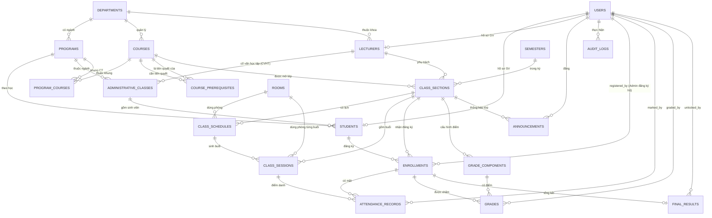
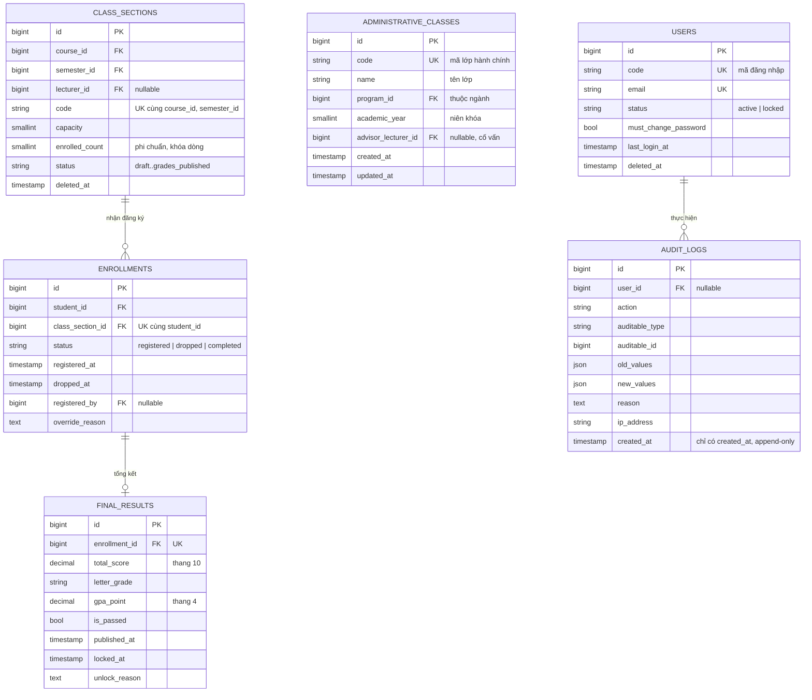

# ERD - Mô hình dữ liệu

Khớp 1-1 với migration trong `app/Modules/*/Database/Migrations` (xem từ điển dữ liệu ở mục 8 của
[requirements.md](../01-requirements/requirements.md)). Bảng chuẩn của Spatie Permission, `jobs`, `cache`,
`sessions`, `notifications` không vẽ.

## Quan hệ

So với sơ đồ gốc của tài liệu, bổ sung các quan hệ vốn đã có FK trong từ điển dữ liệu nhưng chưa vẽ
(`registered_by`, `marked_by`, `graded_by`, `unlocked_by`, `class_sessions.room_id`, chiều "là tiên quyết của").

## Các bảng trọng tâm

## Ràng buộc toàn vẹn đã cài

| Ràng buộc | Nơi thực thi | Test |
|---|---|---|
| unique (student_id, class_section_id) ở `enrollments` | migration | `SchemaIntegrityTest` |
| unique (class_session_id, enrollment_id) ở `attendance_records` | migration | `SchemaIntegrityTest` |
| unique (enrollment_id, grade_component_id) ở `grades` | migration | `SchemaIntegrityTest` |
| unique (course_id, semester_id, code) ở `class_sections` | migration | `SchemaIntegrityTest` |
| course_id <> prerequisite_course_id | CHECK (MySQL) + `PrerequisiteCycleDetector` | `PrerequisiteCycleDetectorTest` |
| enrolled_count không vượt capacity | `lockForUpdate` + `CapacityRule` | `EnrollmentServiceTest` (+ concurrency MySQL, Sprint 3) |
| Dữ liệu học vụ không xóa cứng | `restrictOnDelete` trên FK + soft delete (users, courses, class_sections) | `SchemaIntegrityTest` |
| audit_logs append-only | model chặn update/delete | `AuditTest` |

Quy ước FK: dữ liệu học vụ (`enrollments`, `grades`, `attendance_records`, `final_results`) dùng
`restrictOnDelete`, chỉ dữ liệu con thuần túy (lịch, buổi học, cấu hình điểm của lớp) dùng `cascadeOnDelete`.
