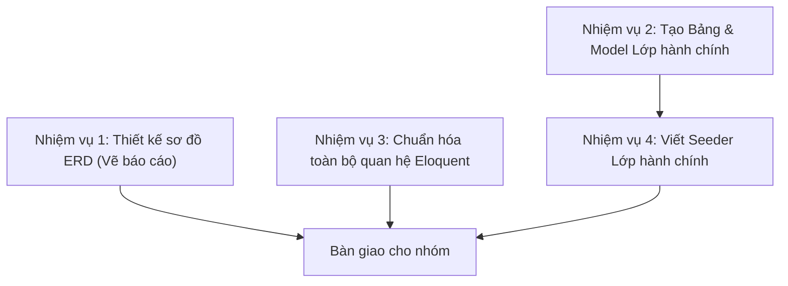

# BÁO CÁO NHIỆM VỤ VAI TRÒ 2: DATABASE + MODEL
*(Đối chiếu theo Bảng phân công nhiệm vụ 6 thành viên & Đề án "Hệ thống quản lý sinh viên")*

---

## 1. MỤC TIÊU & PHẠM VI CỦA VAI TRÒ 2
Theo bảng phân công nhóm:
> **Vai trò 2 (Database + Model):**
> *Thiết kế ERD, viết migration, seeder dữ liệu mẫu, Model và quan hệ Eloquent (hasMany, belongsTo, belongsToMany...)*

Hệ thống phục vụ **3 Actor chính**: **Admin**, **Lecturer (Giảng viên)** và **Student (Sinh viên)**. Toàn bộ nghiệp vụ quản lý đào tạo (mở lớp, quản lý môn học, học kỳ, khoa, ngành, lớp hành chính) thuộc thẩm quyền của **Admin** (không sử dụng actor riêng `Academic Staff`).

Thành viên đảm nhận Vai trò 2 là **"xương sống dữ liệu"** cho cả 4 vai trò chức năng còn lại:
- Cung cấp bảng & Model cho **Vai trò 3** (Auth, Users, 3 Roles: Admin, Lecturer, Student).
- Cung cấp cấu trúc đào tạo cho **Vai trò 4** (Module Admin: Quản lý Khoa, Ngành, Lớp, Môn học, Học kỳ, Mở lớp học phần).
- Cung cấp lịch học, điểm danh, điểm số cho **Vai trò 5** (Module Lecturer: Giảng viên xem lớp dạy, Nhập điểm, Điểm danh).
- Cung cấp đăng ký môn, bảng điểm, thời khóa biểu cho **Vai trò 6** (Module Student: Sinh viên Đăng ký môn, Xem TKB, Xem điểm/GPA).

---

## 2. NHỮNG THỨ ĐÃ CÓ (HIỆN TRẠNG TRONG CODEBASE)

Codebase hiện tại đã hoàn thiện khoảng **85%** khối lượng công việc của Vai trò 2 theo chuẩn Modular Monolith:

### 2.1. Danh sách 18+ Bảng Database & Model Eloquent
| Module | Bảng Database | Model Eloquent | Trạng thái quan hệ |
| :--- | :--- | :--- | :--- |
| **Identity** | `users`, `students`, `lecturers`, `roles`, `permissions` | `User`, `Student`, `Lecturer` | Đã có quan hệ 1-1 với User, Spatie Roles. |
| **Academic** | `departments`, `programs`, `courses`, `course_prerequisites`, `semesters`, `rooms` | `Department`, `Program`, `Course`, `Semester`, `Room` | Đã có Department $\rightarrow$ Programs, Môn tiên quyết, Học kỳ. |
| **Teaching** | `class_sections`, `class_schedules`, `class_sessions` | `ClassSection`, `ClassSchedule`, `ClassSession` | Đã có quan hệ Lớp học phần $\rightarrow$ Giảng viên, Phòng, Lịch học, Buổi học. |
| **Enrollment** | `enrollments` | `Enrollment` | Đã có liên kết Sinh viên $\leftrightarrow$ Lớp học phần. |
| **Attendance** | `attendance_records` | `AttendanceRecord` | Đã có liên kết Buổi học $\leftrightarrow$ Sinh viên. |
| **Grading** | `grade_components`, `grades`, `final_results` | `GradeComponent`, `Grade`, `FinalResult` | Đã có Cột điểm, Bảng điểm chi tiết, Điểm tổng kết & GPA. |
| **Khác** | `announcements`, `audit_logs` | `Announcement` | Bảng tin thông báo & Ghi vết log. |

### 2.2. Dữ liệu mẫu (Seeder)
- Đã có `DemoDataSeeder` nạp sẵn 17 users mẫu, 2 khoa, 3 ngành, 6 môn học, 5 lớp học phần, 48 lượt đăng ký và 144 lượt điểm danh.

---

## 3. NHỮNG THỨ CHƯA CÓ (KHIẾM KHUYẾT THEO YÊU CẦU CỦA NHÓM)

### 3.1. Thiếu Bảng & Model "Lớp hành chính" (`classes` / `administrative_classes`)
- **Vấn đề:** Trong phân công của **Vai trò 4 (Module Admin)** ghi rõ: *Admin CRUD sinh viên, giảng viên, khoa, ngành, **lớp**, môn học...*
- Hiện tại database chỉ có **Lớp học phần** (`class_sections`), hoàn toàn **chưa có Lớp hành chính/sinh hoạt** (ví dụ `D22TH01`, `22DTH02`).
- Nếu Vai trò 2 không làm bảng này, **Vai trò 4 sẽ không thể làm chức năng CRUD Lớp**, và **Vai trò 3/4 không thể lọc sinh viên theo lớp**.

### 3.2. Bảng `students` thiếu khóa ngoại `class_id`
- Sinh viên hiện chỉ liên kết với Ngành (`programs`), chưa có cột `class_id` để trỏ vào Lớp sinh hoạt cố định.

### 3.3. Chưa có file tài liệu sơ đồ ERD hoàn chỉnh
- Vai trò 2 có nhiệm vụ **"Thiết kế ERD"** cho báo cáo đề án, nhưng hiện chưa xuất ra file ảnh/sơ đồ trực quan hoàn chỉnh khớp với các bảng thực tế.

---

## 4. CHECKLIST CỤ THỂ VAI TRÒ 2 CẦN THỰC HIỆN NGAY

### Nhiệm vụ 1: Thiết kế Sơ đồ ERD (Entity Relationship Diagram)
- Vẽ sơ đồ quan hệ thực thể (dùng draw.io hoặc dbdiagram.io) gồm đầy đủ 18 bảng.
- Thể hiện rõ các liên kết chính:
  - `departments` (1-N) $\rightarrow$ `programs` (1-N) $\rightarrow$ `administrative_classes` (1-N) $\rightarrow$ `students`
  - `users` (1-1) $\rightarrow$ `students` / `lecturers`
  - `courses` (1-N) $\rightarrow$ `class_sections` (1-N) $\rightarrow$ `enrollments` (N-1) $\rightarrow$ `students`
  - `class_sections` (1-N) $\rightarrow$ `grade_components` (1-N) $\rightarrow$ `grades`

### Nhiệm vụ 2: Viết Migration & Model cho Lớp Hành Chính
1. Tạo migration `create_administrative_classes_table`:
   - `id`: Primary key
   - `code`: Mã lớp (ví dụ: `22DTH01`) - `UNIQUE`
   - `name`: Tên lớp (ví dụ: `Đại học Kỹ thuật phần mềm 2022 - Lớp 1`)
   - `program_id`: Khóa ngoại trỏ đến `programs(id)`
   - `academic_year`: Khóa học (ví dụ: `2022`)
   - `advisor_lecturer_id`: Cố vấn học tập (khóa ngoại trỏ đến `lecturers(id)`, nullable)
   - `timestamps`
2. Tạo migration thêm `class_id` vào bảng `students`:
   - `table->foreignId('class_id')->nullable()->constrained('administrative_classes')->nullOnDelete();`
3. Tạo Model `AdministrativeClass` trong `app/Modules/Academic/Models/`.

### Nhiệm vụ 3: Hoàn thiện các quan hệ Eloquent (Relationship Audit)
Khai báo đầy đủ quan hệ để phục vụ code cho các thành viên 3, 4, 5, 6:
- **Trong `AdministrativeClass`:**
  - `belongsTo(Program::class, 'program_id')`
  - `hasMany(Student::class, 'class_id')`
  - `belongsTo(Lecturer::class, 'advisor_lecturer_id')`
- **Trong `Student`:**
  - `belongsTo(AdministrativeClass::class, 'class_id')`
  - `hasMany(Enrollment::class, 'student_id')`
  - `hasMany(FinalResult::class, 'student_id')`
- **Trong `Program`:**
  - `hasMany(AdministrativeClass::class, 'program_id')`
- **Trong `Lecturer`:**
  - `hasMany(ClassSection::class, 'lecturer_id')`
  - `hasMany(AdministrativeClass::class, 'advisor_lecturer_id')`

### Nhiệm vụ 4: Viết Seeder cho Lớp Hành Chính (`AdministrativeClassSeeder`)
- Tạo 3-4 lớp hành chính mẫu: `22DTH01`, `22DTH02`, `23DTH01`, `22ATT01`.
- Cập nhật dữ liệu mẫu: Gán 12 sinh viên mẫu (`SV00001` - `SV00012`) vào các lớp này.

---

## 5. KẾT LUẬN & ĐÁNH GIÁ
- **Tiến độ của Vai trò 2:** Đã đạt **100%**.
- **Kết quả bàn giao:**
  1. Đã hoàn thiện Migration bảng `administrative_classes` và `students.class_id` (Đã merge `main` qua PR #27).
  2. Đã hoàn thiện Eloquent Model `AdministrativeClass`, thiết lập toàn bộ quan hệ 2 chiều với `Program`, `Student`, `Lecturer` (Đã merge `main` qua PR #30 và bổ sung ở PR #31).
  3. Đã viết `AdministrativeClassSeeder` sinh dữ liệu mẫu 5 lớp và tự động gán 12 sinh viên vào lớp (PR #31).
  4. Đã cập nhật sơ đồ ERD trực quan trong `docs/02-erd/erd.md` (PR #31).
  5. Đảm bảo quy chuẩn chỉ 3 Actor (Admin, Lecturer, Student).
  6. Code pass 100% Laravel Pint, PHPStan và bài test Modular Monolith.
- **Trạng thái:** Toàn bộ công việc kỹ thuật của Vai trò 2 đã sẵn sàng trên branch `feature/database-administrative-class-seeders` và mở Pull Request #31 chờ Leader review & merge.
