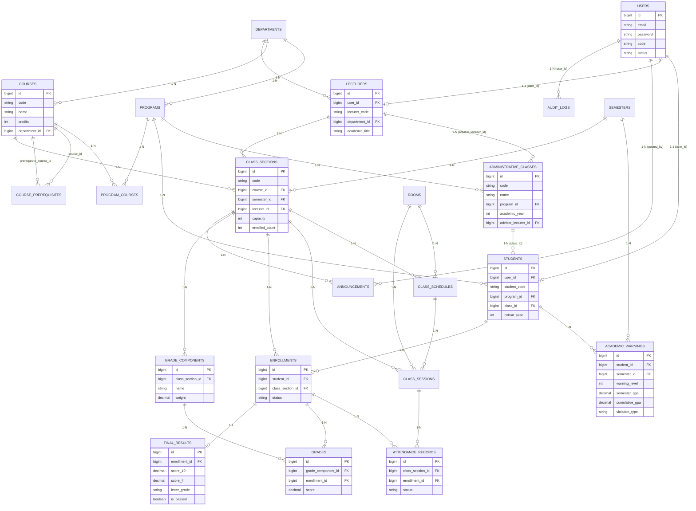
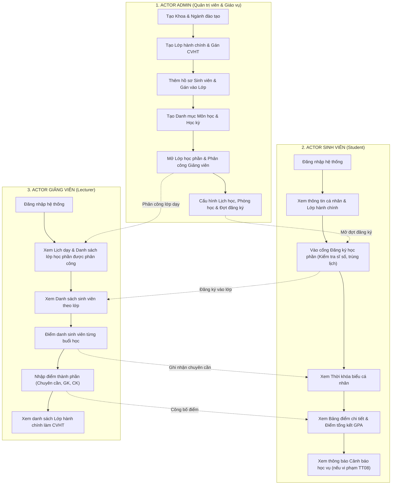

# TỔNG QUAN KIẾN TRÚC DỮ LIỆU & QUAN HỆ HỆ THỐNG: HEXA TECH ACADEMY (SMS)
**Tài liệu chuẩn hóa dành riêng cho Vai trò 2 (Database + Model)**  
**Phạm vi hệ thống:** 3 Actor duy nhất (**Admin**, **Giảng viên**, **Sinh viên**) – Kiến trúc Modular Monolith (Laravel 12, PHP 8.3, MySQL 8).

---

## PHẦN 1: CẤU TRÚC DỮ LIỆU, BẢNG GÌ VÀ LƯU Ở ĐÂU?

Toàn bộ hệ thống gồm **28 bảng**, được quản lý theo từng Module độc lập:

| STT | Tên Bảng (Database Table) | Module phụ trách | Đường dẫn Migration (Lưu ở đâu) | File Model Eloquent | Chức năng nghiệp vụ |
| :---: | :--- | :--- | :--- | :--- | :--- |
| **1** | `users` | `Identity` | `app/Modules/Identity/Database/Migrations/2026_11_04_000100_create_users_table.php` | `User.php` | Tài khoản đăng nhập chung (`email`, `password`, `code`, `status`). |
| **2** | `students` | `Identity` | `app/Modules/Identity/Database/Migrations/2026_11_04_000300_create_students_table.php` `2026_11_11_000101_add_class_id_to_students_table.php` | `Student.php` | Hồ sơ sinh viên, lưu mã SV, ngành, năm khóa và lớp hành chính (`class_id`). |
| **3** | `lecturers` | `Identity` | `app/Modules/Identity/Database/Migrations/2026_11_04_000301_create_lecturers_table.php` `2026_11_09_000100_add_contact_fields_to_admin_and_lecturer_profiles.php` | `Lecturer.php` | Hồ sơ giảng viên, học vị (ThS, TS, PGS.TS), khoa công tác, số điện thoại. |
| **4** | `roles`, `permissions`... | `Identity` | `app/Modules/Identity/Database/Migrations/2026_11_04_000101_create_permission_tables.php` | *(Spatie)* | Phân quyền RBAC cho 3 vai trò: Admin, Lecturer, Student. |
| **5** | `departments` | `Academic` | `app/Modules/Academic/Database/Migrations/2026_11_04_000201_create_departments_table.php` | `Department.php` | Danh mục Khoa / Bộ môn đào tạo (CNTT, Kinh tế...). |
| **6** | `programs` | `Academic` | `app/Modules/Academic/Database/Migrations/2026_11_04_000202_create_programs_table.php` | `Program.php` | Ngành đào tạo trực thuộc khoa (KTPM, HTTT, QTKD...). |
| **7** | `courses` | `Academic` | `app/Modules/Academic/Database/Migrations/2026_11_04_000203_create_courses_table.php` | `Course.php` | Môn học / Học phần (mã môn, tên, số tín chỉ, tiết LT/TH). |
| **8** | `course_prerequisites` | `Academic` | `app/Modules/Academic/Database/Migrations/2026_11_04_000204_create_course_prerequisites_table.php` | *(Pivot Course)* | Ràng buộc môn tiên quyết (môn A phải đạt trước khi học môn B). |
| **9** | `program_courses` | `Academic` | `app/Modules/Academic/Database/Migrations/2026_11_04_000205_create_program_courses_table.php` | *(Pivot)* | Khung chương trình đào tạo của từng ngành theo học kỳ gợi ý. |
| **10** | `semesters` | `Academic` | `app/Modules/Academic/Database/Migrations/2026_11_04_000206_create_semesters_table.php` | `Semester.php` | Học kỳ đào tạo, ngày mở/đóng đợt đăng ký môn, hạn rút môn. |
| **11** | `rooms` | `Academic` | `app/Modules/Academic/Database/Migrations/2026_11_04_000207_create_rooms_table.php` | `Room.php` | Phòng học lý thuyết, phòng lab thực hành, sức chứa chỗ ngồi. |
| **12** | `administrative_classes` ⭐ | `Academic` | `app/Modules/Academic/Database/Migrations/2026_11_11_000100_create_administrative_classes_table.php` | `AdministrativeClass.php` | **Lớp hành chính / sinh hoạt** (ví dụ `22DTH01`), gắn Cố vấn học tập. |
| **13** | `academic_warnings` ⭐ | `Academic` | `app/Modules/Academic/Database/Migrations/2026_11_13_000100_create_academic_warnings_table.php` | `AcademicWarning.php` | **Cảnh báo học vụ (TT08/2021/TT-BGDĐT)**: ĐTBHK, ĐTBCTL năm 1-4, nợ tín chỉ. |
| **14** | `class_sections` | `Teaching` | `app/Modules/Teaching/Database/Migrations/2026_11_04_000401_create_class_sections_table.php` | `ClassSection.php` | Lớp học phần mở trong kỳ (môn nào, giảng viên dạy, sĩ số). |
| **15** | `class_schedules` | `Teaching` | `app/Modules/Teaching/Database/Migrations/2026_11_04_000402_create_class_schedules_table.php` | `ClassSchedule.php` | Lịch học định kỳ hàng tuần (thứ mấy, ca mấy, phòng nào). |
| **16** | `class_sessions` | `Teaching` | `app/Modules/Teaching/Database/Migrations/2026_11_04_000403_create_class_sessions_table.php` | `ClassSession.php` | Từng buổi học cụ thể theo ngày thực tế để điểm danh. |
| **17** | `enrollments` | `Enrollment` | `app/Modules/Enrollment/Database/Migrations/2026_11_04_000501_create_enrollments_table.php` | `Enrollment.php` | Đăng ký học phần của sinh viên (Registered, Dropped, Completed). |
| **18** | `attendance_records` | `Attendance` | `app/Modules/Attendance/Database/Migrations/2026_11_04_000601_create_attendance_records_table.php` | `AttendanceRecord.php` | Bản ghi điểm danh sinh viên trong từng buổi học (Có mặt / Vắng / Trễ). |
| **19** | `grade_components` | `Grading` | `app/Modules/Grading/Database/Migrations/2026_11_04_000701_create_grade_components_table.php` | `GradeComponent.php` | Cột điểm thành phần của lớp (Chuyên cần, Giữa kỳ, Cuối kỳ & % trọng số). |
| **20** | `grades` | `Grading` | `app/Modules/Grading/Database/Migrations/2026_11_04_000702_create_grades_table.php` | `Grade.php` | Điểm thô từng cột thành phần của từng sinh viên. |
| **21** | `final_results` | `Grading` | `app/Modules/Grading/Database/Migrations/2026_11_04_000703_create_final_results_table.php` | `FinalResult.php` | Điểm tổng kết môn: Hệ 10, Hệ 4, Điểm chữ (A, B, C, F), Đạt/Rớt. |
| **22** | `announcements` | `Announcement`| `app/Modules/Announcement/Database/Migrations/2026_11_04_000801_create_announcements_table.php` | `Announcement.php` | Bảng tin thông báo toàn trường hoặc theo từng lớp học phần. |
| **23** | `audit_logs` | `Core` | `database/migrations/2026_11_04_000110_create_audit_logs_table.php` | *(Log)* | Ghi nhật ký thao tác người dùng (IP, User Agent, hành vi nhạy cảm). |
| **24** | `notifications` | `Core` | `database/migrations/2026_11_04_000120_create_notifications_table.php` | *(Laravel)* | Bảng thông báo người dùng của Laravel Notification. |
| **25-28**| `cache`, `jobs`... | `Core` | `database/migrations/0001_01_01_000001_create_cache_table.php`... | *(Core)* | Quản lý Cache và hàng đợi tiến trình nền (Queued Jobs). |

---

## PHẦN 2: TỔNG HỢP CÁC QUAN HỆ (1-1, 1-N, N-N) VÀ KHÓA NGOẠI

### 1. Quan hệ 1 – 1 (One-to-One)
| Bảng A (Gốc) | Bảng B (Tham chiếu) | Khóa ngoại (Foreign Key) | Phương thức Eloquent | Ý nghĩa nghiệp vụ |
| :--- | :--- | :--- | :--- | :--- |
| `users` | `students` | `students.user_id` $\rightarrow$ `users.id` | `$user->student()` `$student->user()` | Mỗi tài khoản sinh viên liên kết duy nhất với 1 hồ sơ học thuật. |
| `users` | `lecturers` | `lecturers.user_id` $\rightarrow$ `users.id` | `$user->lecturer()` `$lecturer->user()` | Mỗi tài khoản giảng viên liên kết duy nhất với 1 hồ sơ giảng viên. |
| `enrollments` | `final_results` | `final_results.enrollment_id` $\rightarrow$ `enrollments.id` | `$enrollment->finalResult()` | Mỗi lượt đăng ký môn học chỉ có duy nhất 1 bản ghi điểm tổng kết môn. |

---

### 2. Quan hệ 1 – N (One-to-Many)
| Bảng Một (1) | Bảng Nhiều (N) | Khóa ngoại (FK) | Phương thức Eloquent | Ý nghĩa nghiệp vụ |
| :--- | :--- | :--- | :--- | :--- |
| `departments` | `programs` | `programs.department_id` | `$dept->programs()` | 1 Khoa (CNTT) quản lý nhiều Ngành đào tạo (KTPM, HTTT). |
| `departments` | `courses` | `courses.department_id` | `$dept->courses()` | 1 Khoa quản lý nhiều Môn học trực thuộc. |
| `departments` | `lecturers` | `lecturers.department_id` | `$dept->lecturers()` | 1 Khoa có nhiều Giảng viên giảng dạy. |
| `programs` | `administrative_classes` | `administrative_classes.program_id` | `$program->administrativeClasses()` | 1 Ngành mở nhiều Lớp sinh hoạt hành chính (`22DTH01`, `22DTH02`). |
| `programs` | `students` | `students.program_id` | `$program->students()` | 1 Ngành có nhiều Sinh viên theo học. |
| `administrative_classes`| `students` | `students.class_id` | `$class->students()` `$student->administrativeClass()` | 1 Lớp sinh hoạt chứa nhiều Sinh viên cùng khóa. |
| `lecturers` | `administrative_classes`| `administrative_classes.advisor_lecturer_id` | `$lecturer->advisedClasses()` `$class->advisorLecturer()` | 1 Giảng viên có thể làm Cố vấn học tập (CVHT) cho nhiều lớp. |
| `students` | `academic_warnings` | `academic_warnings.student_id` | `$student->academicWarnings()` `$warning->student()` | 1 Sinh viên có thể bị ghi nhận nhiều lần Cảnh báo học vụ theo các kỳ. |
| `semesters` | `academic_warnings` | `academic_warnings.semester_id` | `$semester->academicWarnings()` | 1 Học kỳ có danh sách sinh viên bị cảnh báo học vụ. |
| `courses` | `class_sections` | `class_sections.course_id` | `$course->classSections()` | 1 Môn học mở được nhiều Lớp học phần qua các kỳ. |
| `semesters` | `class_sections` | `class_sections.semester_id` | `$semester->classSections()` | 1 Học kỳ mở nhiều Lớp học phần để sinh viên đăng ký. |
| `lecturers` | `class_sections` | `class_sections.lecturer_id` | `$lecturer->classSections()` | 1 Giảng viên được phân công đứng lớp phụ trách nhiều lớp học phần. |
| `class_sections` | `class_schedules` | `class_schedules.class_section_id` | `$section->schedules()` | 1 Lớp học phần có thể có nhiều lịch học trong tuần (VD: Thứ 2 và Thứ 5). |
| `rooms` | `class_schedules` | `class_schedules.room_id` | `$room->schedules()` | 1 Phòng học được xếp cho nhiều lịch học khác nhau. |
| `class_sections` | `class_sessions` | `class_sessions.class_section_id` | `$section->sessions()` | 1 Lớp học phần diễn ra qua nhiều Buổi học thực tế (Buổi 1, 2, 3...). |
| `class_sections` | `enrollments` | `enrollments.class_section_id` | `$section->enrollments()` | 1 Lớp học phần tiếp nhận danh sách nhiều Sinh viên đăng ký. |
| `students` | `enrollments` | `enrollments.student_id` | `$student->enrollments()` | 1 Sinh viên đăng ký học nhiều Lớp học phần trong các kỳ. |
| `class_sessions` | `attendance_records` | `attendance_records.class_session_id` | `$session->attendanceRecords()` | 1 Buổi học có danh sách điểm danh cho toàn bộ sinh viên trong lớp. |
| `enrollments` | `attendance_records` | `attendance_records.enrollment_id` | `$enrollment->attendanceRecords()` | 1 Lượt học môn của sinh viên có lịch sử điểm danh qua các buổi. |
| `class_sections` | `grade_components` | `grade_components.class_section_id` | `$section->gradeComponents()` | 1 Lớp học phần cấu hình nhiều cột điểm (Chuyên cần, Giữa kỳ, Cuối kỳ). |
| `grade_components` | `grades` | `grades.grade_component_id` | `$component->grades()` | 1 Cột điểm chứa điểm số của tất cả sinh viên trong lớp. |
| `enrollments` | `grades` | `grades.enrollment_id` | `$enrollment->grades()` | 1 Lượt học môn của sinh viên có điểm ở từng cột điểm thành phần. |
| `class_sections` | `announcements` | `announcements.class_section_id` | `$section->announcements()` | 1 Lớp học phần có thể nhận nhiều Thông báo học tập. |
| `users` | `announcements` | `announcements.posted_by` | `$user->announcements()` | 1 Người dùng (Admin/GV) có thể đăng nhiều bản tin thông báo. |
| `users` | `audit_logs` | `audit_logs.user_id` | `$user->auditLogs()` | 1 Người dùng thực hiện nhiều thao tác được hệ thống ghi log. |

---

### 3. Quan hệ N – N (Many-to-Many qua bảng trung gian)
| Thực thể A | Thực thể B | Bảng trung gian (Pivot Table) | Khóa ngoại trung gian | Ý nghĩa nghiệp vụ |
| :--- | :--- | :--- | :--- | :--- |
| `courses` | `courses` | `course_prerequisites` | `course_id`, `prerequisite_course_id` | **Môn học tiên quyết:** Môn A là điều kiện tiên quyết của Môn B. |
| `programs` | `courses` | `program_courses` | `program_id`, `course_id` | **Khung chương trình đào tạo:** 1 Ngành gồm nhiều môn học; 1 môn có thể thuộc nhiều ngành. |
| `students` | `class_sections` | `enrollments` | `student_id`, `class_section_id` | **Đăng ký học phần:** Sinh viên đăng ký nhiều lớp; Lớp có nhiều sinh viên. |
| `users` | `roles` | `model_has_roles` | `model_id`, `role_id` | **Phân quyền người dùng (Spatie):** 1 User có thể giữ các quyền/vai trò tương ứng. |

---

## PHẦN 3: SƠ ĐỒ THỰC THỂ LIÊN KẾT (ERD) TƯƠNG TÁC

Dưới đây là sơ đồ Mermaid ERD chuẩn trực quan hóa toàn bộ mối quan hệ giữa 28 bảng trong hệ thống:

---

## PHẦN 4: LUỒNG TƯƠNG TÁC (WORKFLOW) CỦA 3 ACTOR

### 1. Luồng nghiệp vụ của Admin
1. **Thiết lập danh mục cơ sở:** Tạo Khoa (`departments`) $\rightarrow$ Tạo Ngành (`programs`) $\rightarrow$ Tạo Khung môn học (`courses`).
2. **Quản lý lớp sinh hoạt:** Tạo Lớp hành chính (`administrative_classes`), chỉ định Giảng viên phụ trách cố vấn học tập (`advisor_lecturer_id`).
3. **Quản lý nhân sự:** Thêm hồ sơ Sinh viên và gán vào Lớp hành chính tương ứng. Thêm hồ sơ Giảng viên thuộc từng Khoa.
4. **Tổ chức đào tạo:** Tạo Học kỳ (`semesters`), Mở Lớp học phần (`class_sections`), cấu hình phòng học (`rooms`), lịch học (`class_schedules`), phân công Giảng viên phụ trách và mở đợt đăng ký.
5. **Giám sát học vụ:** Chạy tiến trình xét Cảnh báo học vụ (`academic_warnings`) theo quy chế Thông tư 08/2021/TT-BGDĐT.

### 2. Luồng nghiệp vụ của Giảng viên (Lecturer)
1. **Đăng nhập & Tiếp nhận lớp:** Giảng viên đăng nhập, vào Dashboard xem các Lớp học phần mình được Admin phân công dạy trong học kỳ hiện tại.
2. **Xem danh sách lớp:** Xem danh sách sinh viên đăng ký học, kiểm tra tình trạng chuyên cần.
3. **Điểm danh (`Attendance`):** Hàng tuần khi lên lớp, chọn buổi học (`class_sessions`) và bấm điểm danh (`attendance_records`: Có mặt, Vắng, Trễ).
4. **Nhập điểm (`Grading`):** Nhập điểm các cột Chuyên cần, Giữa kỳ, Cuối kỳ theo đúng tỷ lệ phần trăm đã cấu hình (`grade_components`). Hệ thống tự động tính điểm tổng kết.
5. **Cố vấn học tập:** Giảng viên theo dõi tình hình kết quả học tập và danh sách sinh viên bị cảnh báo học vụ của lớp mình làm Cố vấn học tập (`advisedClasses`).

### 3. Luồng nghiệp vụ của Sinh viên (Student)
1. **Đăng nhập & Hồ sơ:** Sinh viên đăng nhập, xem hồ sơ cá nhân, biết mình thuộc Lớp hành chính nào, ngành nào, ai là giảng viên cố vấn.
2. **Đăng ký môn học (`Enrollment`):** Trong thời gian mở cổng, sinh viên xem danh sách các lớp học phần đang mở. Bấm Đăng ký:
   - Hệ thống kiểm tra điều kiện tiên quyết (đã học môn trước chưa).
   - Kiểm tra sĩ số (còn chỗ không).
   - Kiểm tra trùng thời khóa biểu.
   - Nếu thỏa mãn, lưu bản ghi vào `enrollments`.
3. **Thời khóa biểu:** Xem lịch học theo tuần/ngày, biết phòng học và giảng viên giảng dạy.
4. **Xem kết quả học tập & Cảnh báo:** Khi giảng viên công bố điểm, sinh viên tra cứu bảng điểm từng môn, điểm trung bình thang 4 (GPA), tổng số tín chỉ tích lũy, trạng thái Đạt/Không đạt và thông tin Cảnh báo học vụ (nếu có).
